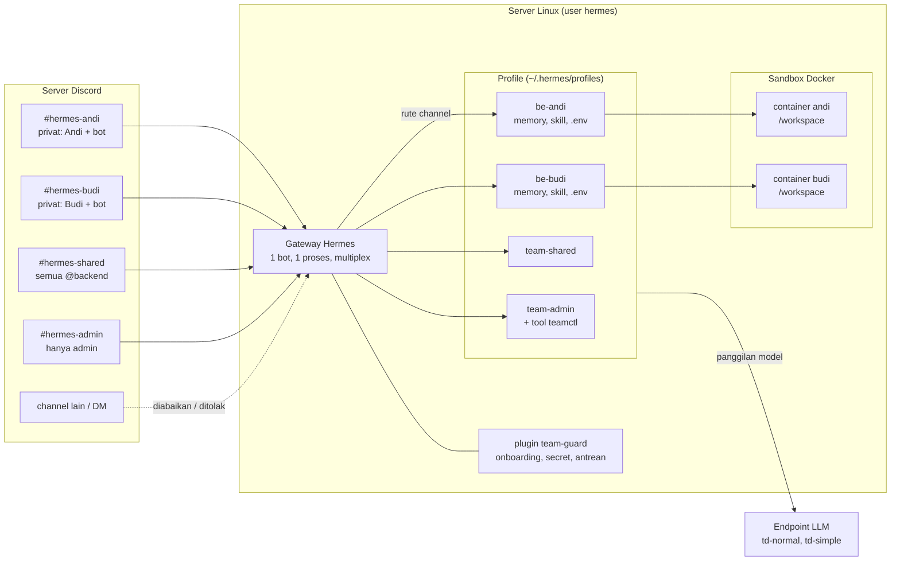
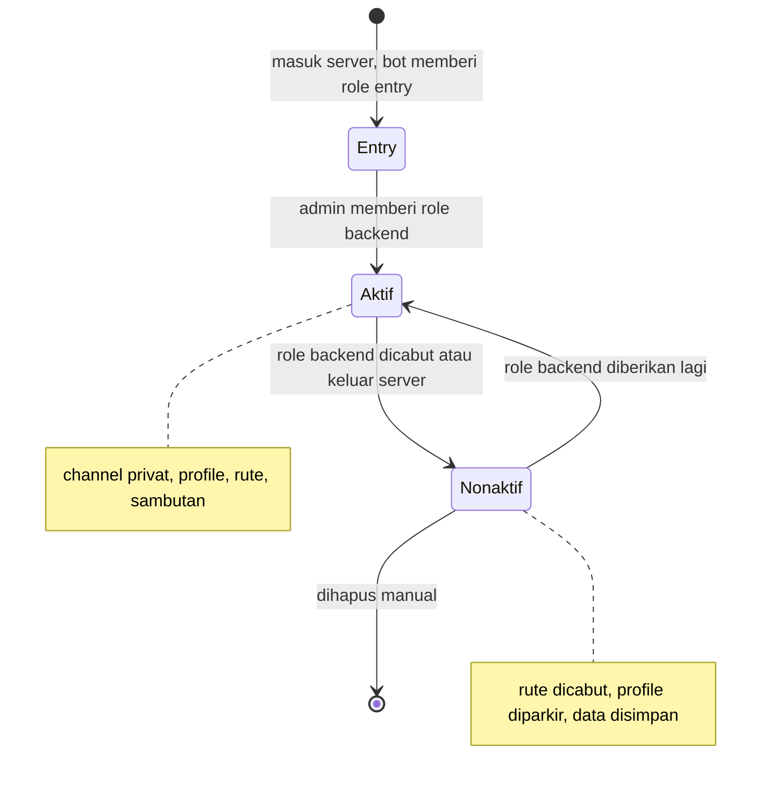

# Hermes untuk tim backend — kit v3.1

Satu instalasi Hermes, satu bot Discord, satu gateway (mode multiplex), dan **satu profile per
orang**. Tiap channel dirutekan ke profile-nya, jadi memory, skill, SOUL.md, config, model,
secret (`.env`), sesi, dan sandbox Docker tiap orang terpisah.

> **Status:** seluruh uji lulus di CI, termasuk uji integrasi yang memuat plugin dan memeriksa rute,
> toolset, key konfigurasi, dan perintah slash terhadap **kode Hermes asli** (commit yang dipin di `HERMES_REF`,
> yang juga dipasang wizard; `main` diuji tanpa memblokir).
> Yang **belum pernah dijalankan**: gateway Hermes yang hidup, server Discord sungguhan, sandbox Docker,
> dan endpoint LLM. Ikuti panduan ini di server uji dulu, dan jalankan `tests/selftest.sh` ([Instalasi manual, Langkah 9](docs/INSTALL.md#langkah-9--provisioning)).

## Gambaran sistem



Ringkasnya:

| Di Discord | Dilayani oleh | Isinya |
|---|---|---|
| `#hermes-<nama>` (privat: orangnya + bot) | profile `be-<nama>` | model, memory, skill, secret, sandbox milik orang itu |
| `#hermes-shared` (semua `@backend`) | profile `team-shared` | skill dan konteks tim; sesi per orang |
| `#hermes-admin` (hanya admin) | profile `team-admin` | tool admin dan kelola server (`teamctl`) |
| channel lain, DM | — | diabaikan / ditolak |
| thread di channel mana pun | profile channel induknya | sesi terpisah per thread |

Siklus anggota:



# Instalasi cepat: satu perintah

**Platform yang didukung:** server Debian 12+ atau Ubuntu 22.04+ dengan **systemd** (VM atau bare metal; x86_64
atau arm64), akses `sudo`, dan Docker Engine sistem (wizard memasangnya bila belum ada; Docker rootless/snap
tidak didukung). Di OS tanpa `apt-get` wizard berhenti di langkah pertama dengan penjelasan; di kontainer/WSL
tanpa systemd ia berhenti kecuali diberi `--no-systemd`.

```bash
git clone https://github.com/soumabali/be-hermes.git
cd be-hermes
sudo bash setup.sh
```

Ini **satu skrip yang didampingi**, bukan pemasangan tanpa tangan. Wizard menjalankan 14 langkah berurutan,
menjelaskan tiap langkah sebelum mengerjakannya, berhenti untuk bertanya, dan bisa dilanjutkan bila terhenti
(jalankan lagi perintah yang sama). Yang tetap kamu kerjakan sendiri:

1. **Di Discord Developer Portal** (Discord tidak menyediakan API untuk ini): *New Application* → tab
   *Installation*: Install Link = None → tab *Bot*: Public Bot mati, Server Members Intent dan Message Content
   Intent hidup → *Reset Token* dan tempel tokennya di prompt wizard.
2. **Di browser:** buka tautan undangan yang dicetak wizard, pilih server, *Authorize*. Bila wizard melaporkan
   role bot berada di bawah role tim: seret role bot ke atas di Server Settings → Roles.
3. **Di terminal:** menyetujui pemasangan Docker dan Hermes (skrip dari internet yang dijalankan di servermu),
   mengetik URL endpoint LLM dan API key, memilih admin tim, dan menjawab pertanyaan lain (Enter = nilai yang
   disarankan).
4. **Sesudahnya, di Discord:** daftar uji dengan akun uji yang dicetak di akhir (5 butir; versi lengkapnya 11 butir).

Perkiraan waktu (belum diukur di server sungguhan): **30–60 menit di depan terminal** untuk pemasangan pertama —
±10 menit di Developer Portal, sisanya menunggu unduhan Docker, installer Hermes, provisioning, dan uji kit
(selftest, beberapa menit) sambil sesekali menjawab. Membangun image sandbox (opsional) menambah waktu dan
bisa dikerjakan belakangan. Jangan tinggalkan terminal: beberapa pertanyaan menunggu jawabanmu.

| # | Langkah | Otomatis? |
|---|---|---|
| 1–3 | Periksa server, pasang Docker/git, buat user `hermes` | Ya |
| 4 | Sambungkan bot Discord | **Sebagian**: kamu membuat aplikasi bot di Developer Portal dan mengklik tautan undangan; wizard memberi instruksi, memeriksa token dan intent, lalu menunggu bot masuk server |
| 5 | Buat role `entry`/`backend`/`hermes-admin`, kategori, `#hermes-shared`, `#hermes-admin`; catat semua ID | Ya (tidak ada lagi salin-tempel ID) |
| 6 | Endpoint LLM dan API key (diuji dengan satu permintaan kecil) | Ya, kamu mengetik URL dan key |
| 7 | Zona waktu, thread, channel laporan pemakaian, tiga pembatas skala (anggaran token per orang/tim, panggilan LLM paralel; Enter = nilai yang disarankan) | Ya |
| 8–9 | Pasang Hermes pada commit yang diuji CI (`HERMES_REF`; tanpa menyalakan gateway) dan kit | Ya, setelah kamu setujui |
| 10–11 | Tulis `team.yaml`, `/etc/hermes/.env`, `apply`, kebijakan managed | Ya |
| 12 | Opsional: image sandbox, timer pemakaian dan laporan, pelapor sandbox menganggur (hanya melapor), pemantau gateway | Ya |
| 13–14 | Jalankan gateway, `doctor`, uji kit terhadap Hermes di server itu (selftest; bawaan ya), ringkasan dan daftar uji | Ya |

Wizard mencatat commit Hermes yang benar-benar terpasang dan memperingatkan bila berbeda dari `HERMES_REF`.
Menjalankan ulang `sudo bash setup.sh` kapan saja aman: langkah yang beres dilewati, dan gateway yang ternyata
mati dinyalakan lagi serta dilaporkan.

Perintah yang berguna:

```bash
sudo bash setup.sh --list       # status tiap langkah
sudo bash setup.sh --dry-run    # tampilkan yang akan dilakukan, tanpa mengubah apa pun
sudo bash setup.sh --from llm   # ulangi mulai langkah tertentu (langkah sesudahnya ditandai belum selesai)
sudo bash setup.sh --no-systemd # server tanpa systemd: lewati langkah yang butuh systemd (tanpa ini, wizard berhenti)
sudo bash setup.sh --reset      # lupakan kemajuan (tidak menghapus yang sudah terpasang)
```

Tanpa tanya-jawab (mis. untuk server kedua): `HERMES_SETUP_BOT_TOKEN=… HERMES_SETUP_LLM_KEY=… sudo -E bash
setup.sh --non-interactive --answers jawaban.yaml`. Token dan key hanya dibaca dari variabel lingkungan;
berkas jawaban yang memuatnya ditolak. Kunci jawaban yang menyangkut keamanan: `adopt_existing_roles` dan
`adopt_existing_channels` (memakai ulang role/channel yang sudah ada di server butuh persetujuan eksplisit),
`admin_allow_bot` (admin berupa bot), dan `allow_http_llm` (endpoint LLM `http://` ditolak tanpa ini).
Kunci yang punya bawaan (boleh tidak ditulis; berkas jawaban lama tetap berlaku): `hermes_pin` (bawaan `true`:
pasang commit `HERMES_REF`; `false` = rilis stable terbaru), `hermes_repin` (`false`; `true` = pindahkan Hermes yang
sudah terpasang ke commit itu), `daily_token_budget` (`3000000`), `team_daily_token_budget` (`30000000`),
`max_llm_parallel` (`10`) — ketiganya `0` = tanpa batas —, `sandbox_idle_timer` (`true`, hanya melapor),
`gateway_watch_timer` (`false`), dan `run_selftest` (`true`).
Kode keluar: 0 sukses, 1 gagal di satu langkah, 2 state/jawaban rusak, 3 wizard lain sedang berjalan, 130 dibatalkan.
Wizard menyalin kit ke `/opt/hermes-team` hanya dari daftar berkas yang diizinkan, dan menolak `--kit-dir`
yang bukan path absolut, folder sistem, atau folder yang bukan salinan kit sebelumnya.

Token bot dan API key tidak pernah ditulis ke berkas state wizard (`/var/lib/hermes-team-setup/state.json`),
log, atau argumen perintah.

> Wizard ini diuji terhadap Discord tiruan dan perintah tiruan (ratusan uji). Ia **belum pernah dijalankan di
> server sungguhan**. Pakai di server uji dulu; bila satu langkah gagal, pesan galatnya menyebut penyebab
> yang paling mungkin dan cara melanjutkan. Panduan manual di bawah menjelaskan apa yang dikerjakan tiap langkah.

---

## Dokumentasi

| Dokumen | Isi |
|---|---|
| [Instalasi manual](docs/INSTALL.md) | Langkah demi langkah tanpa wizard, pemecahan masalah, upgrade dan rollback kit |
| [Fitur dan isi kit](docs/FITUR.md) | Apa saja yang ada, dan fungsi tiap berkas |
| [Onboarding](docs/ONBOARDING.md) | User baru → role → channel pribadi → sambutan; keluar tim; live reload |
| [Tool admin](docs/ADMIN.md) | Yang bisa diminta admin di `#hermes-admin`, termasuk kelola server Discord dan pagarnya |
| [Panduan anggota](docs/ANGGOTA.md) | Model terkunci, secret pribadi (`/env-set`), thread dan memory |
| [Skala 20 orang](docs/SKALA.md) | Pembatas berlapis, anggaran token, mengukur kapasitas, RAM sandbox |
| [Pencatatan pemakaian](docs/PEMAKAIAN.md) | Token dan request per orang, laporan terjadwal, metrik |
| [Operasional](docs/OPERASI.md) | Tabel operasi, backup dan pemulihan, pindah server, rotasi token dan key, hapus anggota, gateway mati dan pemantaunya |
| [Perubahan perilaku v3.1](docs/PERUBAHAN-V3.1.md) | Yang berbeda dari v3.0 dan perlu diketahui admin |
| [Batasan](docs/BATASAN.md) | Yang belum atau tidak bisa dilakukan kit |
| [Referensi konfigurasi](docs/KONFIGURASI.md) | Semua key `team.yaml`: tipe, bawaan, arti (dibangkitkan dari skema) |
| [Panduan pengembang](docs/PENGEMBANGAN.md) | Peta kode; cara menambah setelan, tool admin, pembatas, jenis profile; uji dan rilis |
| [Kontrak antar komponen](docs/KONTRAK.md) | Berkas dan baris yang dipertukarkan kit, plugin, teamctl, dan tools |
| [Rencana skala](docs/RENCANA-SKALA.md) | Celah skala yang diketahui dan status perbaikannya |
| [Akseptansi](docs/AKSEPTANSI.md) | Daftar pemeriksaan di server sungguhan untuk menilai kit 10/10, dan pekerjaan kode yang tersisa |
| [CHANGELOG](CHANGELOG.md) | Perubahan per versi |
