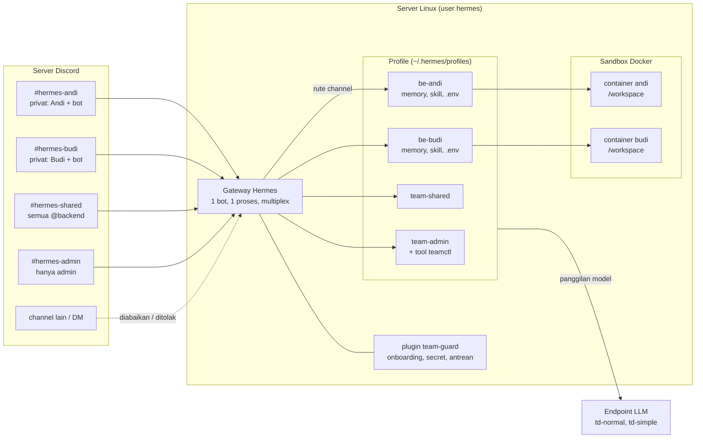
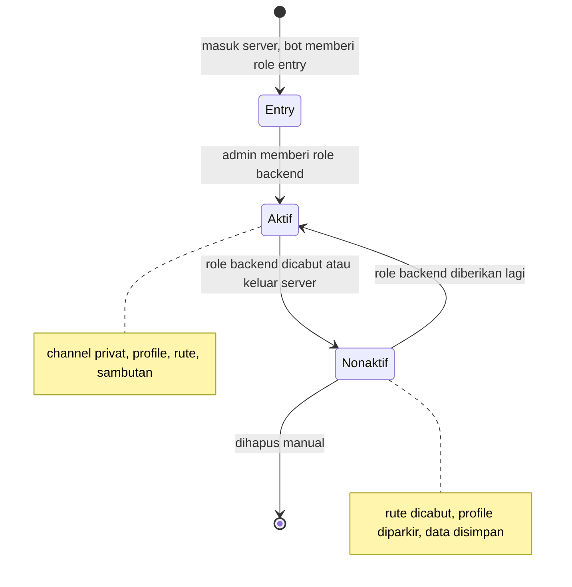

# Hermes untuk tim backend — kit v3.1

Satu instalasi Hermes, satu bot Discord, satu gateway (mode multiplex), dan **satu profile per
orang**. Tiap channel dirutekan ke profile-nya, jadi memory, skill, SOUL.md, config, model,
secret (`.env`), sesi, dan sandbox Docker tiap orang terpisah.

> **Status:** seluruh uji lulus di CI, termasuk uji integrasi yang memuat plugin dan memeriksa rute,
> toolset, key konfigurasi, dan perintah slash terhadap **kode Hermes asli** (versi yang dipin dan `main`).
> Yang **belum pernah dijalankan**: gateway Hermes yang hidup, server Discord sungguhan, sandbox Docker,
> dan endpoint LLM. Ikuti panduan ini di server uji dulu, dan jalankan `tests/selftest.sh` ([Instalasi manual, Langkah 9](docs/INSTALL.md#langkah-9--provisioning)).

## Gambaran sistem



Ringkasnya:

| Di Discord | Dilayani oleh | Isinya |
|---|---|---|
| `#hermes-<nama>` (privat: orangnya + bot) | profile `be-<nama>` | model, memory, skill, secret, sandbox milik orang itu |
| `#hermes-shared` (semua `@backend`) | profile `team-shared` | skill dan konteks tim; sesi per orang |
| `#hermes-admin` (hanya admin) | profile `team-admin` | tool admin dan kelola server (`teamctl`) |
| channel lain, DM | — | diabaikan / ditolak |
| thread di channel mana pun | profile channel induknya | sesi terpisah per thread |

Siklus anggota:



# Instalasi cepat: satu perintah

Di server Ubuntu/Debian baru:

```bash
git clone https://github.com/soumabali/be-hermes.git
cd be-hermes
sudo bash setup.sh
```

Wizard menjalankan 14 langkah berurutan, menjelaskan tiap langkah sebelum mengerjakannya, dan bisa
dilanjutkan bila terhenti (jalankan lagi perintah yang sama).

| # | Langkah | Otomatis? |
|---|---|---|
| 1–3 | Periksa server, pasang Docker/git, buat user `hermes` | Ya |
| 4 | Sambungkan bot Discord | **Sebagian**: kamu membuat aplikasi bot di Developer Portal dan mengklik tautan undangan; wizard memberi instruksi, memeriksa token dan intent, lalu menunggu bot masuk server |
| 5 | Buat role `entry`/`backend`/`hermes-admin`, kategori, `#hermes-shared`, `#hermes-admin`; catat semua ID | Ya (tidak ada lagi salin-tempel ID) |
| 6 | Endpoint LLM dan API key (diuji dengan satu permintaan kecil) | Ya, kamu mengetik URL dan key |
| 7 | Zona waktu, thread, channel laporan pemakaian | Ya |
| 8–9 | Pasang Hermes (tanpa menyalakan gateway) dan kit | Ya |
| 10–11 | Tulis `team.yaml`, `/etc/hermes/.env`, `apply`, kebijakan managed | Ya |
| 12 | Opsional: image sandbox, timer pemakaian dan laporan | Ya |
| 13–14 | Jalankan gateway, `doctor`, ringkasan dan daftar uji | Ya |

Perintah yang berguna:

```bash
sudo bash setup.sh --list       # status tiap langkah
sudo bash setup.sh --dry-run    # tampilkan yang akan dilakukan, tanpa mengubah apa pun
sudo bash setup.sh --from llm   # ulangi mulai langkah tertentu
sudo bash setup.sh --reset      # lupakan kemajuan (tidak menghapus yang sudah terpasang)
```

Tanpa tanya-jawab (mis. untuk server kedua): `HERMES_SETUP_BOT_TOKEN=… HERMES_SETUP_LLM_KEY=… sudo -E bash
setup.sh --non-interactive --answers jawaban.yaml`. Token dan key hanya dibaca dari variabel lingkungan;
berkas jawaban yang memuatnya ditolak.

Token bot dan API key tidak pernah ditulis ke berkas state wizard (`/var/lib/hermes-team-setup/state.json`),
log, atau argumen perintah.

> Wizard ini diuji terhadap Discord tiruan dan perintah tiruan (57 uji). Ia **belum pernah dijalankan di
> server sungguhan**. Pakai di server uji dulu; bila satu langkah gagal, pesan galatnya menyebut penyebab
> yang paling mungkin dan cara melanjutkan. Panduan manual di bawah menjelaskan apa yang dikerjakan tiap langkah.

---

## Dokumentasi

| Dokumen | Isi |
|---|---|
| [Instalasi manual](docs/INSTALL.md) | Langkah demi langkah tanpa wizard, pemecahan masalah, upgrade |
| [Fitur dan isi kit](docs/FITUR.md) | Apa saja yang ada, dan fungsi tiap berkas |
| [Onboarding](docs/ONBOARDING.md) | User baru → role → channel pribadi → sambutan; keluar tim; live reload |
| [Tool admin](docs/ADMIN.md) | Yang bisa diminta admin di `#hermes-admin`, termasuk kelola server Discord dan pagarnya |
| [Panduan anggota](docs/ANGGOTA.md) | Model terkunci, secret pribadi (`/env-set`), thread dan memory |
| [Skala 20 orang](docs/SKALA.md) | Pembatas berlapis, anggaran token, mengukur kapasitas, RAM sandbox |
| [Pencatatan pemakaian](docs/PEMAKAIAN.md) | Token dan request per orang, laporan terjadwal, metrik |
| [Operasional](docs/OPERASI.md) | Tabel operasi, backup, rotasi token dan key, hapus anggota, pindah server, rollback |
| [Perubahan perilaku v3.1](docs/PERUBAHAN-V3.1.md) | Yang berbeda dari v3.0 dan perlu diketahui admin |
| [Batasan](docs/BATASAN.md) | Yang belum atau tidak bisa dilakukan kit |
| [Referensi konfigurasi](docs/KONFIGURASI.md) | Semua key `team.yaml`: tipe, bawaan, arti (dibangkitkan dari skema) |
| [Panduan pengembang](docs/PENGEMBANGAN.md) | Peta kode; cara menambah setelan, tool admin, pembatas, jenis profile; uji dan rilis |
| [Kontrak antar komponen](docs/KONTRAK.md) | Berkas dan baris yang dipertukarkan kit, plugin, teamctl, dan tools |
| [Rencana skala](docs/RENCANA-SKALA.md) | Celah skala yang diketahui dan status perbaikannya |
| [CHANGELOG](CHANGELOG.md) | Perubahan per versi |
