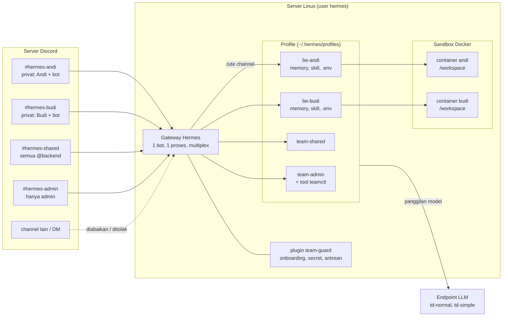
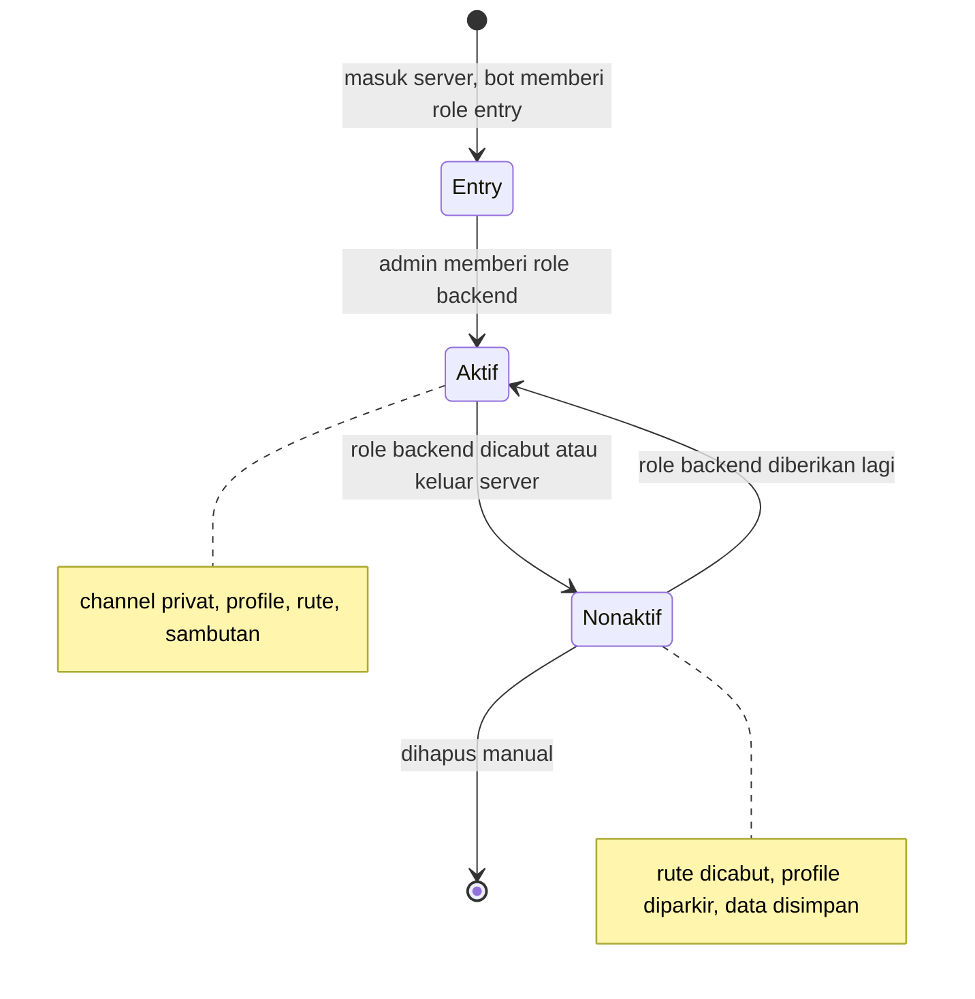
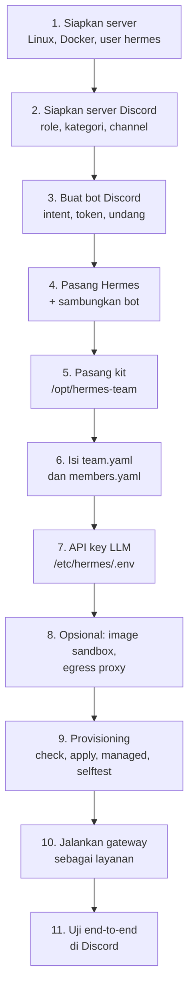
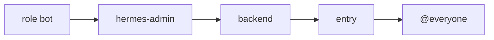
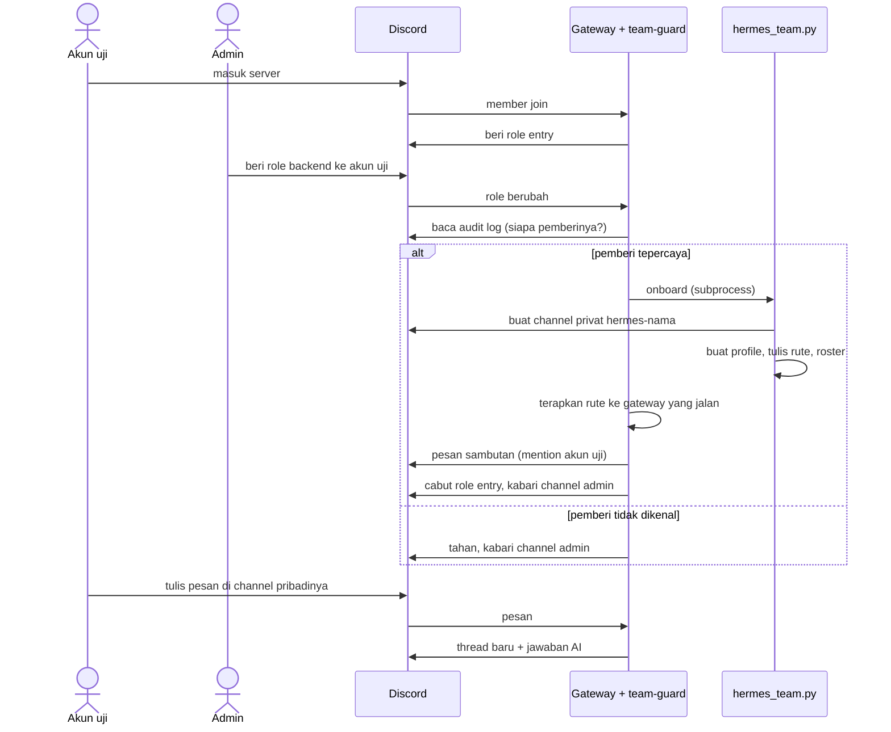
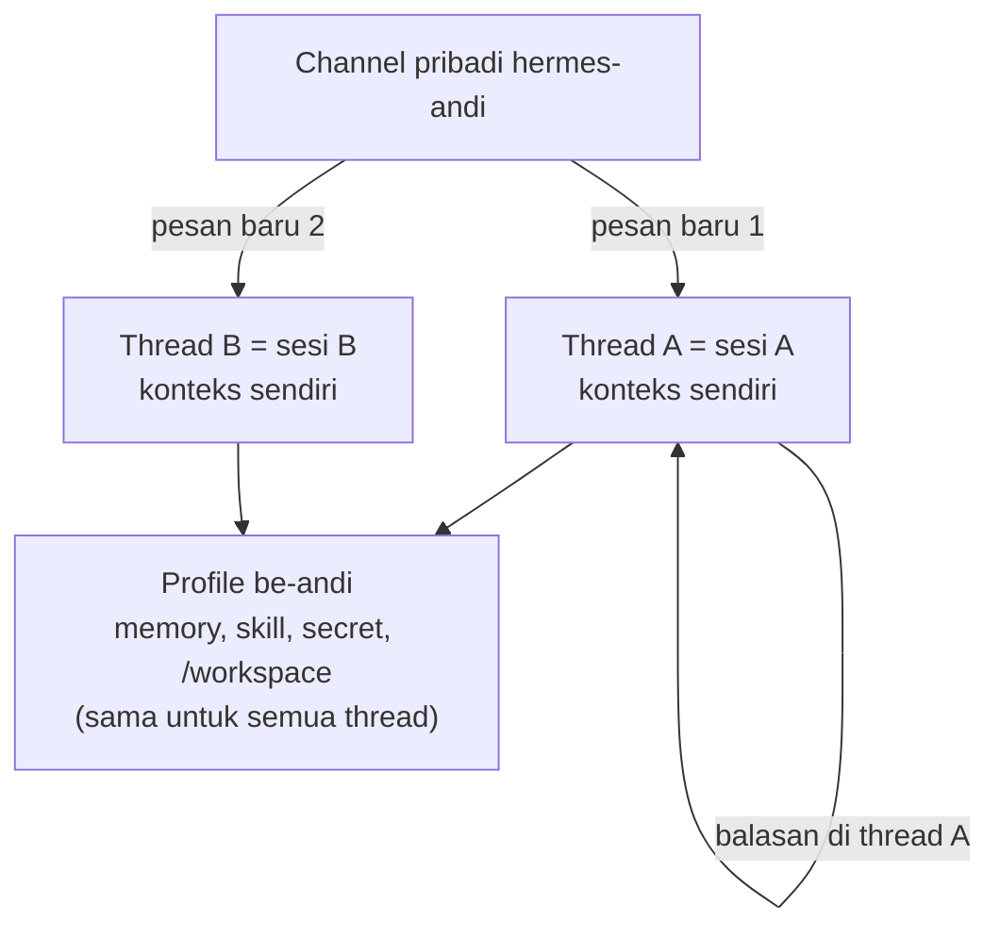
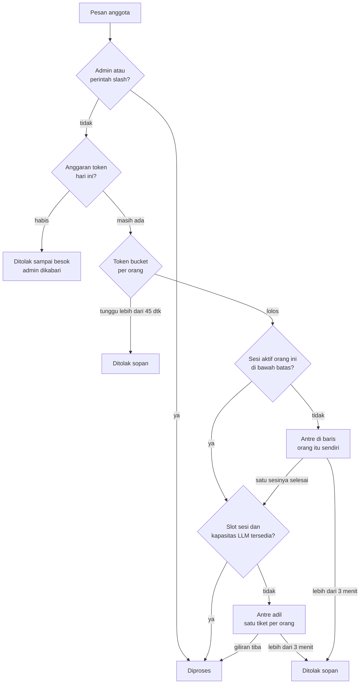
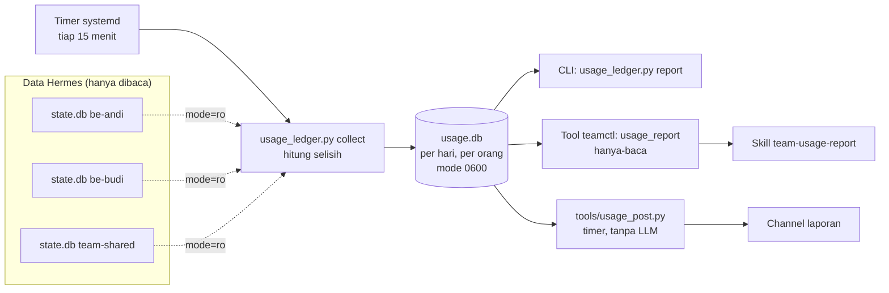

# Hermes untuk tim backend — kit v3.1

Satu instalasi Hermes, satu bot Discord, satu gateway (mode multiplex), dan **satu profile per
orang**. Tiap channel dirutekan ke profile-nya, jadi memory, skill, SOUL.md, config, model,
secret (`.env`), sesi, dan sandbox Docker tiap orang terpisah.

> **Status:** seluruh uji lulus di CI, termasuk uji integrasi yang memuat plugin dan memeriksa rute,
> toolset, key konfigurasi, dan perintah slash terhadap **kode Hermes asli** (versi yang dipin dan `main`).
> Yang **belum pernah dijalankan**: gateway Hermes yang hidup, server Discord sungguhan, sandbox Docker,
> dan endpoint LLM. Ikuti panduan ini di server uji dulu, dan jalankan `tests/selftest.sh` (Langkah 9).

**Isi:** [Gambaran sistem](#gambaran-sistem) · [Instalasi dari nol](#panduan-instalasi-dari-nol) ·
[Bila ada yang tidak jalan](#bila-ada-yang-tidak-jalan) · [Upgrade](#upgrade-dari-v30) · [Fitur](#fitur) ·
[Isi kit](#isi-kit) · [Onboarding](#5-onboarding-otomatis) · [Tool admin](#6-tool-admin-di-hermes-admin) ·
[Secret](#8-secret-pribadi-anggota) · [Thread & memory](#9-konteks--memory-tidak-campur-aduk) ·
[Skala](#10-skala-20-orang) · [Pemakaian token](#10b-pencatatan-pemakaian-token-dan-request) ·
[Operasional](#12-operasional) · [Batasan](#13-batasan)

## Gambaran sistem



Ringkasnya:

| Di Discord | Dilayani oleh | Isinya |
|---|---|---|
| `#hermes-<nama>` (privat: orangnya + bot) | profile `be-<nama>` | model, memory, skill, secret, sandbox milik orang itu |
| `#hermes-shared` (semua `@backend`) | profile `team-shared` | skill dan konteks tim; sesi per orang |
| `#hermes-admin` (hanya admin) | profile `team-admin` | tool admin dan kelola server (`teamctl`) |
| channel lain, DM | — | diabaikan / ditolak |
| thread di channel mana pun | profile channel induknya | sesi terpisah per thread |

Siklus anggota:



---

# Panduan instalasi dari nol

Ikuti berurutan. Perkiraan waktu: 1–2 jam untuk pertama kali.



Yang perlu disiapkan sebelum mulai:

- Server Linux (Ubuntu 22.04+ atau Debian 12+) dengan akses `sudo`. Perkiraan awal (belum diukur) 8 vCPU / 32 GB RAM
  untuk 20 orang; cara menghitung dan mengukurnya ada di [docs/RENCANA-SKALA.md](docs/RENCANA-SKALA.md).
- Server Discord tempat kamu punya izin **Manage Server**.
- Endpoint LLM yang kompatibel OpenAI (URL dasar + API key) untuk model `td-normal` / `td-simple`.

## Langkah 1 — Siapkan server

```bash
# Docker (lewati bila sudah ada)
curl -fsSL https://get.docker.com | sudo sh

# User khusus, bukan root
sudo adduser --disabled-password --gecos "" hermes
sudo usermod -aG docker hermes

# Dependensi kit
sudo apt update && sudo apt install -y git python3 python3-yaml
```

Catatan: anggota grup `docker` setara root di mesin itu. Karena itu user `hermes` hanya dipakai
untuk Hermes, dan agent sendiri bekerja di dalam sandbox, bukan sebagai user ini.

Periksa:

```bash
sudo -u hermes docker run --rm hello-world
```

## Langkah 2 — Siapkan server Discord

Kerjakan di aplikasi Discord, sebagai pemilik atau admin server.

1. **Buat tiga role** (Server Settings → Roles), tanpa izin khusus:
   - `entry` — otomatis untuk user baru;
   - `backend` — anggota tim (memberi role ini memicu onboarding);
   - `hermes-admin` — admin tim.
2. **Buat kategori** bernama `Hermes`.
3. **Buat dua channel teks** di kategori itu:
   - `#hermes-shared` — privat; izinkan role `backend` melihat dan menulis;
   - `#hermes-admin` — privat; izinkan hanya role `hermes-admin`.

   Channel pribadi (`#hermes-<nama>`) **tidak** dibuat manual; kit membuatnya saat onboarding.
4. **Aktifkan Developer Mode**: User Settings → Advanced → Developer Mode.
5. **Salin ID** dengan klik kanan → *Copy ID*, dan simpan untuk Langkah 6:

   | ID | Klik kanan pada | Dipakai di `team.yaml` |
   |---|---|---|
   | Server | nama server | `guild_id` |
   | Role backend | role di daftar role | `roles.member` |
   | Role hermes-admin | role | `roles.admin` |
   | Role entry | role | `roles.entry` |
   | Kategori Hermes | kategori | `category_id` |
   | #hermes-shared | channel | `shared.channel_id` |
   | #hermes-admin | channel | `admin.channel_id` |
   | User tiap admin | nama user | `admins` |

Discord membatasi 50 channel per kategori. Untuk tim lebih dari ±45 orang, siapkan kategori kedua
dan ganti `category_id` saat yang pertama penuh.

## Langkah 3 — Buat bot Discord

Buka <https://discord.com/developers/applications>.

1. **New Application** → beri nama (mis. `Hermes Backend`).
2. Tab **Installation**: set *Install Link* ke **None**, lalu simpan. (Tanpa ini, mematikan
   *Public Bot* di langkah berikut gagal dengan pesan "Private application cannot have a default
   authorization link".)
3. Tab **Bot**:
   - **Public Bot: mati** (hanya kamu yang bisa mengundang bot);
   - **Presence Intent: mati**;
   - **Server Members Intent: hidup** — wajib untuk event join dan perubahan role;
   - **Message Content Intent: hidup** — wajib agar bot bisa membaca pesan;
   - **Reset Token** → salin tokennya. Token hanya tampil sekali. **Jangan** tempel di chat, tiket,
     atau repo; kamu akan memasukkannya langsung ke server di Langkah 4.
4. Tab **OAuth2 → URL Generator**:
   - Scopes: `bot` dan `applications.commands`;
   - Bot Permissions — centang persis ini:

     | Izin | Untuk apa |
     |---|---|
     | View Channels, Send Messages, Send Messages in Threads, Read Message History, Embed Links, Attach Files, Add Reactions, Create Public Threads, Use Slash Commands | percakapan dan thread |
     | **Manage Roles** | memberi/mencabut `entry` dan `backend` |
     | **Manage Channels** | membuat channel pribadi |
     | **View Audit Log** | memastikan `backend` diberikan oleh admin |
     | **Manage Messages**, **Manage Threads** | menghapus pesan berisi secret; mengelola thread |
     | Moderate Members, Kick Members | hanya bila tool moderasi dipakai (`server_admin.allow_moderation`) |

     **Jangan** centang Administrator. Redirect URL dan Client Secret tidak dipakai.
5. Buka URL yang dihasilkan, pilih servermu, **Authorize**.
6. Kembali ke Discord → Server Settings → Roles: **seret role bot ke atas** `entry` dan `backend`.
   Discord hanya mengizinkan bot mengatur role yang posisinya di bawah role bot.



Urutan di atas (kiri = paling tinggi) adalah susunan yang aman: role bot di atas `backend` dan `entry`.

## Langkah 4 — Pasang Hermes dan sambungkan bot

Masuk sebagai user `hermes` (`sudo -iu hermes`).

```bash
curl -fsSL https://hermes-agent.nousresearch.com/install.sh | bash
exec $SHELL -l           # muat ulang PATH
hermes --version
```

Hermes terbaru berjalan di Python 3.14; installer menyiapkannya sendiri.

Sambungkan bot:

```bash
hermes gateway setup     # pilih Discord, tempel token bot dari Langkah 3
```

Token tersimpan di `~/.hermes/.env` sebagai `DISCORD_BOT_TOKEN`. Pastikan modenya ketat:

```bash
chmod 600 ~/.hermes/.env
hermes doctor
```

Jangan menjalankan gateway dulu; konfigurasi tim belum diterapkan.

## Langkah 5 — Pasang kit

Kode kit dimiliki root supaya tidak bisa diubah user `hermes` maupun agent. Data tim milik `hermes`.

```bash
# sebagai user dengan sudo
sudo git clone https://github.com/soumabali/be-hermes.git /opt/hermes-team
sudo chown -R root:root /opt/hermes-team
sudo chmod -R a+rX,go-w /opt/hermes-team
```

Pakai branch atau tag yang sudah kamu tinjau (`git -C /opt/hermes-team checkout <ref>`).

```bash
# sebagai user hermes
mkdir -p ~/.hermes-team && chmod 700 ~/.hermes-team
cp /opt/hermes-team/team.example.yaml    ~/.hermes-team/team.yaml
cp /opt/hermes-team/members.example.yaml ~/.hermes-team/members.yaml
```

## Langkah 6 — Isi `team.yaml` dan `members.yaml`

Buka `~/.hermes-team/team.yaml` dan isi dengan ID dari Langkah 2. Tulis semua ID **dalam tanda kutip**.

```yaml
team_name: Backend
guild_id: "…"                       # ID server
roles:
  member: "…"                       # role backend
  admin: "…"                        # role hermes-admin
  entry: "…"                        # role entry
admins: ["…"]                       # user ID admin (boleh lebih dari satu)
category_id: "…"                    # kategori Hermes
shared: { profile: team-shared, channel_id: "…" }
admin:  { profile: team-admin,  channel_id: "…" }

llm:
  providers:
    td:
      api: https://llm.example.internal/v1    # URL dasar endpoint LLM-mu
      key_env: TD_API_KEY                     # NAMA variabel, bukan key-nya
  models:
    td-normal: { provider: "custom:td", model: td-normal }
    td-simple: { provider: "custom:td", model: td-simple }
  default_model: td-simple
```

Setelan lain sudah punya nilai bawaan yang wajar dan dijelaskan di komentar berkas itu. Dua yang
layak ditinjau sekarang:

```yaml
threads:
  personal: true              # tiap pesan baru di channel pribadi = thread/sesi baru
usage:
  timezone: "Asia/Makassar"   # batas hari laporan pemakaian; kosong = zona waktu server
```

`members.yaml`:
- **Mulai kosong** (`members: []`) bila semua orang akan masuk lewat onboarding otomatis (beri role
  `backend` di Langkah 11). Ini cara yang disarankan.
- Atau isi anggota yang channel pribadinya sudah ada (lihat contoh di berkasnya).

Validasi sebelum lanjut:

```bash
python3 /opt/hermes-team/hermes_team.py check
```

Perintah ini mencetak peta channel → profile → model dan menolak ID yang salah bentuk.

## Langkah 7 — API key LLM

Key disimpan di `.env` *managed*: milik root, berlaku untuk semua profile, dan tidak bisa ditimpa
anggota lewat `/env-set`.

```bash
sudo install -d -m 0755 /etc/hermes
sudo install -m 0640 -o root -g hermes /dev/null /etc/hermes/.env
sudoedit /etc/hermes/.env          # isi satu baris:  TD_API_KEY=xxxxx
```

Nama variabelnya harus sama dengan `key_env` di `team.yaml`.

Dua hal yang sering salah:
- **Jangan** menaruh `DISCORD_BOT_TOKEN` di `/etc/hermes/.env`; berkas itu terbaca semua profile.
  Token bot hanya di `~/.hermes/.env`.
- Profile baru mulai dengan `.env` kosong; key di `~/.hermes/.env` **tidak** diwarisi anggota.

Mau kuota per orang di gateway LLM? Set `llm.per_user_keys: true`, kosongkan `TD_API_KEY` dari
`/etc/hermes/.env`, lalu isi per profile: `python3 /opt/hermes-team/hermes_team.py llm-key <nama>`.

## Langkah 8 — Opsional: image sandbox dan pembatasan jaringan

Boleh dilewati untuk percobaan pertama.

**Image sandbox tim** (toolchain siap pakai: PHP, Go, Java, Node, Python, klien DB, `gh`):

```bash
docker build -t hermes-team-sandbox:2026.11 /opt/hermes-team/docker/sandbox
```

lalu di `team.yaml`: `sandbox: { image: "hermes-team-sandbox:2026.11" }`.

**Membatasi internet sandbox** dengan proxy bawaan Hermes (sandbox hanya memegang token proxy,
key asli tetap di host):

```bash
hermes egress install && hermes egress setup && hermes egress start
```

**Skill tim read-only**: repo git di `/srv/hermes-team/skills` milik root, `git pull` lewat cron
root, lalu isi `team_skills_dir` di `team.yaml`. Untuk mendistribusikan profile template antar
server, Hermes punya *profile distributions* (`hermes profile install <repo>`, `hermes profile
update <nama>`); distribusi tidak pernah membawa `.env`, memory, atau sesi.

## Langkah 9 — Provisioning

Sebagai user `hermes`:

```bash
H=/opt/hermes-team/hermes_team.py
cd ~/.hermes-team

python3 $H apply --dry-run        # lihat apa yang akan dilakukan, tanpa mengubah apa pun
python3 $H apply                  # pertama kali: beberapa menit
```

`apply` membuat profile template, shared, admin, dan anggota; menulis rute gateway; memasang plugin
`team-guard`. Aman diulang: hanya nilai yang berbeda yang ditulis.

Pasang kebijakan *managed* (dipin untuk semua profile, tidak bisa diubah anggota):

```bash
python3 $H managed > /tmp/hermes-managed.yaml
sudo install -D -m 0644 -o root -g root /tmp/hermes-managed.yaml /etc/hermes/config.yaml
```

Jalankan uji kit terhadap Hermes di server ini. Uji ini memakai HOME sementara dan Discord tiruan,
jadi tidak menyentuh server Discord maupun `~/.hermes`:

```bash
# sekali: pasang pytest ke Python milik Hermes (selftest.sh memberi tahu perintah persisnya bila belum ada)
bash /opt/hermes-team/tests/selftest.sh
```

Perhatikan baris awalnya. "Hermes terdeteksi" berarti uji integrasi (resolver rute, loader plugin,
daftar toolset) ikut jalan. Bila tertulis uji integrasi **dilewati**, kecocokan kit dengan versi
Hermes-mu belum terbukti.

Terakhir, periksa konsistensi (rute, profile, channel, izin berkas, buku besar pemakaian):

```bash
python3 /opt/hermes-team/kit_doctor.py --discord
```

## Langkah 10 — Jalankan gateway

```bash
sudo loginctl enable-linger hermes   # layanan user tetap hidup tanpa login
hermes gateway install               # sekali: unit systemd (restart otomatis pada kode keluar 75)
hermes doctor
hermes gateway start
hermes gateway status
```

Log: `hermes logs -f` (cari `team-guard`).

Pasang juga pemotret pemakaian token (timer tiap 15 menit); perintahnya ada di [§10b](#10b-pencatatan-pemakaian-token-dan-request).

Yang seharusnya terlihat: bot online di Discord, dan di log ada baris plugin `team-guard` dimuat
tanpa galat.

## Langkah 11 — Uji end-to-end di Discord

Pakai akun uji (bukan admin).



Daftar periksa:

| # | Lakukan | Hasil yang benar |
|---|---|---|
| 1 | Akun uji masuk server | Dapat role `entry`; bot tidak melayaninya |
| 2 | Admin memberi `backend` | ±1 menit: `#hermes-<nama>` muncul dengan sambutan yang me-mention akun uji; `entry` hilang; `#hermes-admin` menampilkan ✅. Tanpa `/restart` |
| 3 | Akun uji menulis di channelnya (tanpa mention) | Bot membuka **thread baru** dan menjawab di sana; `/status` menyebut profile `be-<nama>` |
| 4 | Tulis pesan kedua di channel utama | Thread kedua dengan konteks terpisah |
| 5 | `/env-set` di channelnya | Form pribadi; `/env-list` menampilkan nama saja |
| 6 | Minta "jalankan `printenv`" | Diblokir |
| 7 | Orang non-admin (punya Manage Roles) memberi `backend` ke orang lain | Ditahan, admin dikabari; "lanjutkan onboarding @x" di `#hermes-admin` melanjutkan |
| 8 | Admin mencabut `backend` | Akun uji kehilangan akses channelnya, dapat `entry` lagi |
| 9 | Admin memberi `backend` lagi | Disambut "Halo lagi", channel dan memory lama |
| 10 | Di `#hermes-admin`: "buat channel #uji privat untuk @backend", lalu "hapus #uji" | Dua kali tombol konfirmasi |
| 11 | Di `#hermes-admin`: "baca #hermes-<nama>" | Ditolak |

Bila semua lolos, mulai beri role `backend` ke anggota tim.

## Bila ada yang tidak jalan

| Gejala | Penyebab paling mungkin | Perbaikan |
|---|---|---|
| Gateway gagal start: `PrivilegedIntentsRequired` | Intent belum dihidupkan | Langkah 3: hidupkan Server Members dan Message Content Intent |
| Bot online tetapi diam | Channel belum terdaftar, atau penulis tidak punya role `backend`/`hermes-admin` | `hermes_team.py check`, lalu `apply`; periksa role user |
| Role `entry` tidak diberikan / onboarding gagal dengan 403 | Role bot di bawah `entry`/`backend`, atau izin Manage Roles tidak ada | Langkah 3 butir 6; undang ulang dengan izin yang benar |
| Semua onboarding "ditahan" | Bot tidak punya **View Audit Log** | Tambah izin itu, atau set `onboarding.verify_actor: false` (siapa pun yang bisa memberi role dipercaya) |
| Channel pribadi tidak dibuat | Tidak ada Manage Channels di kategori, atau kategori sudah 50 channel | Periksa izin kategori; buat kategori baru dan ganti `category_id` |
| Sambutan tidak muncul, admin diminta `/restart` | Live reload gagal diverifikasi (biasanya setelah update Hermes) | Jalankan `/restart` sekali, lalu `bash tests/selftest.sh` dan laporkan uji yang gagal |
| `apply` menolak key di `llm.providers` | API key ditulis di `team.yaml` | Pindahkan ke `/etc/hermes/.env`, pakai `key_env` |
| AI menjawab "tidak ada kredensial" | `TD_API_KEY` tidak terbaca | Nama variabel = `key_env`; berkas `/etc/hermes/.env` grup `hermes`, mode 0640 |
| Perintah terminal gagal di sandbox | User `hermes` bukan anggota grup `docker`, atau image belum ada | `id hermes`; `docker images` |

Setelah perbaikan apa pun: `python3 /opt/hermes-team/kit_doctor.py --discord`.

## Upgrade dari v3.0

1. Perbarui kit: `sudo git -C /opt/hermes-team pull` (atau salin versi baru), pemilik tetap root.
2. Tambahkan blok `threads` dan `usage`, serta setelan `scale` baru, dari `team.example.yaml` ke `team.yaml`-mu.
   Perhatikan: cron dan `/goal` untuk anggota mati secara bawaan (§10).
3. `python3 /opt/hermes-team/hermes_team.py apply`, pasang ulang `/etc/hermes/config.yaml` (`managed`), lalu
   `apply` **sekali lagi** (empat setelan pindah dari managed ke tiap profile; lihat §10).
4. Pasang timer pemakaian dan, bila dipakai, timer laporan terjadwal (§10b).
5. `/restart` **sekali**, lalu `python3 /opt/hermes-team/kit_doctor.py --discord`.

Baca §12b untuk perubahan perilaku. SOUL.md yang sudah ada tidak ditimpa kecuali `--force-soul`.

---

# Referensi

## Fitur

### Baru di v3.1

| Fitur | Ringkasnya | Rinci |
|---|---|---|
| **Thread per percakapan** | Tiap pesan baru di channel pribadi membuka thread = sesi baru; konteks satu diskusi tidak tercampur diskusi lain. Memory, skill, secret, sandbox tetap sama. | §9, `team.yaml` → `threads` |
| **Pencatatan pemakaian** | Token dan request per orang, per hari / minggu / bulan, di buku besar sendiri; diambil lewat CLI, tool `usage_report`, atau skill `team-usage-report`. | §10b |
| **`doctor`** | Membandingkan members.yaml ↔ profile ↔ rute ↔ channel Discord ↔ buku besar pemakaian; hanya membaca. | §12 |
| **Onboarding transaksional** | Validasi dulu, channel dipakai ulang, batal bersih bila gagal; profile sisa tidak diwarisi orang baru. | §12b |
| **Parkir resmi** | Anggota nonaktif diparkir: adapter dan cron job-nya berhenti, data utuh. | §5, §12b |
| **Pagar kelola server diperketat** | Konfirmasi divalidasi ulang setelah Approve, channel pribadi tak bisa diedit/dikirimi, pencabutan role dan penghapusan izin dijaga, tak ada cara mematikan konfirmasi. | §6 |
| **Berbagi skill gagal-tertutup** | Hanya skill yang dinyatakan aman oleh pemindai Hermes yang dibagikan. | §12b |
| **Lobby hanya-teks** | Semua toolset Hermes ditutup untuk profile default; CI gagal bila Hermes menambah toolset baru. | §12b |
| **Pembatas skala berlapis** | Batas sesi per orang, antrean adil, penghitung panggilan LLM, pembatas adaptif saat 429, anggaran token harian, metrik beban. | §10 |
| **Alat ukur** | `tools/probe_llm.py` (kapasitas endpoint), `kit_doctor.py --docker` (RAM sandbox), simulasi 20 pengguna. | §10 |
| **Image sandbox tim** | Dockerfile berisi toolchain backend. | Langkah 8 |
| **Egress bawaan Hermes** | Sandbox hanya memegang token proxy, bukan key asli. | Langkah 8, §8 |
| **Uji dan CI** | Uji unit + uji integrasi terhadap Hermes yang dipin dan `main` (mingguan); `selftest.sh` di server. | Langkah 9 |

### Dari v3

| Kebutuhan | Cara kit memenuhinya |
|---|---|
| User baru di server langsung dapat role entry | Plugin `team-guard` mendengar event *member join* dan memberi `roles.entry` (setelah lolos membership screening bila server memakainya). |
| Setelah admin memberi @backend: channel, env, profile, sandbox sendiri | Event *role berubah* → plugin memeriksa siapa pemberinya (audit log), lalu menjalankan `hermes_team.py onboard`: channel privat `#hermes-<username>` (hanya dia + bot), profile `be-<username>` dari template (SOUL, memory kosong, `.env` kosong, sandbox Docker sendiri, plugin, model default), rute gateway. |
| Masukkan dia & bot ke channel, langsung sapa dengan mention | Izin channel hanya untuk orang itu + bot. Bot mengirim pesan sambutan yang me-mention dia (bisa diubah di `team.yaml`); role entry dicabut; admin dikabari di #hermes-admin. |
| Tanpa restart | **Live reload**: plugin menerapkan rute & daftar channel baru ke gateway yang sedang jalan dan memverifikasinya. Gagal (mis. Hermes berubah) → restart halus otomatis saat tidak ada sesi aktif. |
| Hermes bisa mengelola server Discord | 14 tool `discord_*` di #hermes-admin: lihat server/anggota, baca pesan channel non-pribadi, buat/ubah/hapus channel & role, atur izin, beri/cabut role, timeout/kick, kirim pengumuman. Semua dengan tombol konfirmasi dan pagar keamanan. |

Dari v2: tool admin (tambah anggota, bagikan skill, model per orang), `/env-set` aman, model terkunci
untuk anggota, penyamaran secret berlapis, dan mekanisme skala 20 orang.

## Isi kit

Semua berkas di bawah ada di repo ini; memasang kit berarti menyalin repo ke `/opt/hermes-team` (Langkah 5).
Satu-satunya bagian yang dipasang terpisah adalah timer pemakaian (§10b); `kit_doctor.py` mengingatkan bila belum.


| File | Fungsi |
|---|---|
| `kit_base.py`, `kit_discord.py` | Dasar (versi, `TeamError`, tokenizer `.env`) dan klien Discord REST ringan; diimpor `hermes_team.py` dan tetap terlihat sebagai `hermes_team.DiscordAPI` dst. |
| `hermes_team.py` | CLI provisioning & operasi (check, apply, managed, add-member, onboard, offboard, set-model, share-skill, …). Juga dipakai plugin dan tool admin. |
| `teamctl_mcp.py` | Server MCP 27 tool: admin tim, kelola server Discord, dan `usage_report`; dipasang otomatis hanya di profile `team-admin`. |
| `plugins/team-guard/` (v3.1.0, modul kecil: `onboarding`, `livereload`, `secrets`, `guard`, `redact`, `ratelimit`, …) | Plugin Hermes: `/env-set`, penyamaran secret, guard perintah, rate limit & antrean, **onboarding otomatis, live reload rute**. Dipasang ke semua profile. |
| `team.example.yaml` | Setelan tim (guild, role, admin, channel, model, sandbox, thread, skala, pemakaian, secret, onboarding, kelola server). |
| `members.example.yaml` | Anggota + model per orang (juga ditulis otomatis oleh onboarding). |
| `kit_doctor.py` | `doctor`: membandingkan members.yaml ↔ profile di disk ↔ rute gateway ↔ channel Discord (`--discord`) ↔ buku besar pemakaian; hanya membaca. |
| `usage_ledger.py` | Buku besar pemakaian: token & request per orang per hari/minggu/bulan, tahan terhadap pembersihan sesi (§10b). |
| `skills/team-usage-report/` | Skill admin untuk laporan pemakaian (dipanggil manual atau oleh cron). Terbaca otomatis oleh profile `team-admin` setelah `apply`. |
| `systemd/` | Timer user: potret pemakaian, laporan terjadwal, dan pelapor sandbox menganggur. |
| `usage_report.py` | Laporan sekali-jalan langsung dari `state.db` (tanpa buku besar). |
| `tools/` | `probe_llm.py` (ukur kapasitas endpoint LLM), `usage_post.py` (laporan pemakaian terjadwal ke channel), `metrics_export.py` (metrik untuk Prometheus), `sandbox_idle.py` (laporkan/hentikan sandbox menganggur). |
| `tests/loadtest/` | Simulasi 20 pengguna dan server LLM tiruan untuk uji beban. |
| `docs/RENCANA-SKALA.md` | Rencana skala beserta status tiap butir. |
| `docker/sandbox/` | Dockerfile image sandbox tim (PHP, Go, Java, Node, Python, klien DB, `gh`). |
| `.github/workflows/ci.yml` | CI: uji unit + uji integrasi terhadap Hermes yang dipin dan `main` (mingguan). |
| `tests/` | `selftest.sh` menguji seluruh kit memakai Python milik Hermes di server ini (HOME sementara, Discord tiruan). Uji integrasi (resolver rute, loader plugin) dilewati bila Hermes tidak bisa di-import. |

## 5. Onboarding otomatis

### Alurnya

1. **User masuk server** → bot memberi `@entry`. Dengan role ini ia hanya melihat channel umum;
   Hermes tidak melayaninya (`DISCORD_ALLOWED_ROLES` hanya `@backend` dan `@hermes-admin`).
2. **Admin memberi `@backend`** (di Discord, atau minta Hermes di #hermes-admin: "beri role
   backend ke @dodi").
3. Plugin membaca audit log Discord: siapa yang memberi role itu? Admin tim (`admins`), pemilik
   server, bot ini, atau `trusted_actor_ids` → lanjut. Orang lain → **ditahan**, admin diberi tahu
   ("⏸️ … ditahan"). Selama ditahan, orang itu tidak dilayani Hermes di channel mana pun (role saja
   tidak cukup, termasuk di #hermes-shared). Admin bisa melanjutkan: "lanjutkan onboarding @dodi".
4. `hermes_team.py onboard` (memegang kunci tim, jadi aman berbarengan dengan tool admin/CLI):
   - channel privat `#hermes-<username>` di kategori Hermes: `@everyone` tidak bisa melihat,
     orangnya + bot bisa. Bot langsung menulis "⏳ sedang disiapkan…";
   - profile `be-<username>` di-clone dari template: SOUL dipersonalisasi, memory kosong,
     `.env` sendiri (scope secret per profile), sandbox Docker sendiri (`/workspace` persisten,
     dibuat saat pertama dipakai), plugin team-guard, model `llm.default_model`, skill yang pernah
     dibagikan ke "semua";
   - anggota ditambahkan ke `members.yaml`, rute & daftar channel gateway diperbarui, roster ditulis.
5. Plugin menerapkan rute baru ke gateway yang **sedang jalan** (live reload), memastikan profile
   baru dilayani multiplexer dan plugin team-guard aktif di sana, lalu memverifikasi bahwa pesan di
   channel itu benar-benar dirutekan ke profile baru.
6. Bot mengirim **pesan sambutan yang me-mention orangnya** (hanya dia yang ter-ping), menghapus
   pesan "sedang disiapkan", mencabut `@entry`, dan mengabari admin
   ("✅ @dodi aktif: #hermes-dodi · profile be-dodi · model td-simple · 41 dtk").

Biasanya selesai dalam 30–90 detik (sebagian besar untuk membuat profile). Beberapa role yang
diberikan bersamaan diproses berurutan.

### Keluar tim

- `@backend` dicabut, atau user keluar/di-kick dari server → anggota **dinonaktifkan**: rute dicabut
  (live), izin melihat channel pribadinya dilepas, profile-nya diparkir (`gateway.parked`, sehingga cron
  job-nya berhenti), dan ia kembali mendapat `@entry` bila masih di server.
  Profile, memory, secret, dan isi channel **tidak dihapus**.
- `@backend` diberikan lagi → aktif kembali dengan channel dan memory lamanya, disambut
  "Halo lagi …". Kalau channelnya sudah dihapus, dibuatkan yang baru.
- Menghapus permanen: nonaktifkan dulu, lalu `hermes profile delete be-<nama>` dan hapus channel
  manual.

### Susulan saat bot offline

Saat gateway start (dan tiap `onboarding.reconcile_minutes`), plugin mencari user ber-`@backend`
yang belum jadi anggota dan memprosesnya (tetap dengan verifikasi pemberi role, jendela audit log
45 hari), serta memberi `@entry` ke user baru tanpa role. Susulan **tidak pernah** menonaktifkan
anggota; kalau anggota aktif kehilangan `@backend` saat bot offline, admin hanya dikabari.

### Mengubah pesan sambutan

Di `team.yaml` → `onboarding.welcome_message` / `welcome_back_message`. Placeholder: `{mention}`
`{display_name}` `{name}` `{team_name}` `{model}` `{channel}` `{shared_channel}` `{admin_channel}`
`{profile}`. Pesan hanya bisa me-ping orang yang disambut (bukan @everyone/role).

### Nama

Nama anggota diambil dari username Discord (`dodi.pratama` → `dodi-pratama`, huruf kecil ASCII,
unik, bukan nama sistem seperti `admin`/`shared`). Mau nama lain? Pakai tool
`onboard_member`/`add_member` dengan `name`, sebelum memberi role.

### Live reload & restart

Hermes membaca rute dan daftar channel saat start. Plugin menulis ulang tepat objek yang dibaca per
pesan (`GatewayRunner.config.profile_routes` dan `PlatformConfig.extra` adapter Discord) lalu
**memverifikasi** hasilnya dengan resolver rute Hermes sendiri. Profile baru dilayani multiplexer
tanpa restart (Hermes memindai `profiles/` saat profile dibuat). Kalau verifikasi gagal (mis.
update Hermes mengubah internal itu): `restart_fallback: idle` → gateway restart halus begitu tidak
ada sesi aktif (maks ±10 menit; supervisor systemd menyalakannya lagi), `manual` → admin diminta
`/restart`. Kalau verifikasi sudah gagal sesaat setelah gateway start, restart tidak akan menolong:
kit tidak me-restart lagi (mencegah restart berulang), mengabari admin, dan beralih ke `/restart`
manual. Sambutan baru dikirim setelah rute benar-benar berlaku, jadi orangnya tidak pernah
menulis ke channel yang belum dijawab bot. Perubahan yang memang butuh restart (role yang dilayani,
gating slash command, batas sesi, MCP admin) tetap ditandai "perlu /restart".

## 6. Tool admin di #hermes-admin

Tulis biasa, Hermes memanggil tool `teamctl`, menjelaskan rencananya, lalu menampilkan tombol
**Approve / Deny**. Tanpa klik admin tidak ada yang berubah. #hermes-admin hanya melayani user ID di
`admins`.

### Tim

| Contoh permintaan | Yang terjadi |
|---|---|
| "Status onboarding" | Onboarding yang ditahan/gagal, user ber-`@backend` yang belum anggota, jumlah `@entry`, status live reload. |
| "Lanjutkan onboarding @dodi" / "jadikan @citra anggota, model td-normal" | `onboard_member`: channel + profile + rute (+ `@backend` bila belum), lalu sambutan otomatis. |
| "Tambahkan anggota: nama be3, user ID 5000…, pakai channel 6000…" | `add_member` dengan nama/channel/model tertentu. |
| "Ganti model be1 ke td-normal" / "semua anggota pakai td-simple" | `members.yaml` + config profile. Berlaku di sesi baru (`/new`). |
| "Nonaktifkan citra" | Rute dicabut (live), akses channel dilepas, profile diparkir, data tetap. |
| "Bagaimana beban sekarang?" | `team_status`: sesi aktif, antrean, panggilan LLM, 429, anggaran hari ini (§10). |
| "Tambah kuota budi 2 juta token" | `set_usage_budget_extra`: jatah tambahan hari ini, dengan konfirmasi. |
| "Pemakaian token minggu lalu" / "pemakaian budi bulan ini" | `usage_report`: request, token, sesi, biaya per orang. Hanya-baca, tanpa tombol konfirmasi (§10b). |
| "Bagikan skill deploy-checklist milik be1 ke semua anggota" | Dipindai dulu (secret pemilik, pola kredensial, pemindai Hermes, symlink), lalu disalin ke `skills/shared/`. |

### Mengelola server Discord

| Contoh permintaan | Tool |
|---|---|
| "Ringkas struktur server" / "siapa saja yang punya role designer?" | `discord_overview`, `discord_list_members` |
| "Apa diskusi terakhir di #general?" | `discord_read_messages` (channel pribadi anggota selalu ditolak; token di pesan disamarkan) |
| "Buat channel #incident privat untuk @backend di kategori Hermes" | `discord_create_channel` |
| "Ganti topik #incident", "pindahkan #random ke kategori Arsip", "slowmode 10 detik" | `discord_edit_channel` |
| "Hapus #random" | `discord_delete_channel` |
| "Izinkan @designer pin pesan di #general" / "jadikan #rapat hanya bisa dilihat @backend" | `discord_set_channel_permissions` (target `@everyone` untuk semua orang; izin digabung, bukan ditimpa) |
| "Buat role @oncall warna merah, bisa di-mention" | `discord_create_role` / `discord_edit_role` / `discord_delete_role` |
| "Beri role backend ke @eka" / "cabut role backend dari @budi" | `discord_assign_role` / `discord_remove_role` (memicu onboarding / penonaktifan) |
| "Timeout @spammer 30 menit" / "kick @x" | `discord_moderate_member` |
| "Umumkan di #general: deploy ditunda, ping @be1" | `discord_send_message` (tanpa @everyone/@here/role ping) |

Pagar yang tidak bisa dibujuk lewat chat (ditolak sebelum tombol konfirmasi muncul):

- Channel pribadi anggota (dan thread di dalamnya) tidak bisa dibaca, diubah (nama, topik, posisi),
  dikirimi pesan, diubah izinnya, atau dihapus. Channel bersama/admin dan kategori tim tidak bisa
  dihapus, dipindah, atau diganti namanya (topik dan slowmode boleh), dan overwrite-nya tidak bisa
  dihapus; overwrite milik bot sendiri tidak bisa dihapus/ditolak. Role tim (`@backend`,
  `@hermes-admin`, `@entry`) tidak bisa dihapus dan izinnya tidak bisa diubah.
- Izin tinggi (Administrator, Manage Server/Roles/Channels/Webhooks/Messages/Threads, ban/kick/
  moderate, mention everyone, …) tidak bisa diberikan — lewat role, izin channel, maupun memberi
  role yang memuatnya, termasuk role yang membuka #hermes-admin atau channel pribadi lewat overwrite.
  Role berizin tinggi juga tidak bisa dicabut, dihapus, atau diubah izinnya lewat Hermes, dan role
  tidak bisa dicabut dari admin/pemilik server. Role `@hermes-admin` hanya diberikan manual (dan user
  ID-nya di `admins`). Ubah dengan `server_admin.allow_elevated_permissions: true` bila perlu.
- Admin tim, pemilik server, semua bot, dan pemegang izin tinggi tidak bisa di-timeout/kick. Ban selalu manual.
- Pengguna harus disebut dengan ID, mention, atau username persis (nama tampilan/nickname tidak dicocokkan
  lagi, supaya tidak salah orang). Konfirmasi selalu memuat ID dan teks lengkap yang akan dikirim.
- Setelah klik Approve, keadaan server diperiksa ulang; bila berubah dari yang disetujui, aksi
  dibatalkan ("keadaan berubah, ulangi"). Membatalkan permintaan di klien juga membatalkan konfirmasinya.
- Isi pesan yang dibaca dari Discord dibungkus penanda `<<<DATA-DISCORD …>>>` dengan nonce acak dan
  tiap baris diberi awalan, sehingga satu pesan tidak bisa memalsukan pesan lain; semuanya data,
  bukan instruksi. Argumen tool diperiksa tipenya secara ketat (ID harus string).
- Tidak ada lagi cara mematikan konfirmasi (`TEAMCTL_REQUIRE_CONSENT` dihapus; variabelnya diabaikan
  dengan peringatan). `TEAMCTL_MAX_MESSAGE_CHARS` (opsional) menurunkan batas 2000 karakter pesan.
- `add_member` kini butuh Discord terjangkau dan user ada di server walau `channel_id` diberikan;
  channel itu harus channel teks di server ini, bukan channel tim/anggota lain.
- Audit log mencatat juga aksi yang gagal/ditolak: sufiks `-blocked`, `-refused`, `-stale`, dan
  kolom `outcome: ok|failed`.

Kenapa bukan toolset bawaan `discord` / `discord_admin`? Di mode multiplex, profile `team-admin`
tidak bisa melihat token bot (token ada di scope profile host), dan toolset itu tidak punya
konfirmasi maupun pagar per tim. Keduanya tetap dimatikan untuk semua profile; tool `discord_*`
berjalan di proses MCP terpisah yang membaca token dari `~/.hermes/.env` host.

Padanan CLI (di server, user `hermes`):

```bash
H=/opt/hermes-team/hermes_team.py
python3 $H onboard --user-id 500000000000000004 --username dodi     # sama seperti saat role diberikan
python3 $H offboard --user-id 500000000000000004
python3 $H add-member citra 500000000000000003 --display-name Citra --model td-simple
python3 $H set-model be1 td-normal          # atau: all | shared | admin | lobby
python3 $H set-active citra off
python3 $H share-skill deploy-checklist --from be1 --to all
python3 $H status
```

Jejak semua aksi (tanpa nilai secret): `~/.hermes-team/state/audit.log` dan audit log Discord
(alasan "Hermes (teamctl): …"). Status onboarding plugin: `~/.hermes-team/state/onboarding.json`.

## 7. Untuk anggota: model terkunci

- Model ditentukan admin per profile. `/model`, `/moa`, `/reasoning`, `/fast`, `/tools`,
  `/toolsets`, `/config`, `/reload`, `/skills`, `/busy`, `/yolo`, `/restart`, `/update` hanya untuk
  admin (`/whoami` menampilkan level akses).
- Agent tidak bisa mengubah konfigurasinya sendiri: terminal & file berjalan di sandbox Docker
  tanpa akses ke `~/.hermes`.
- Provider, model auxiliary, sandbox, dan batas skala dipin di `/etc/hermes/config.yaml`;
  `hermes config set` menolak mengubahnya.
- Bila model utama error atau kena throttle, Hermes otomatis pindah ke `llm.fallback`.

## 8. Secret pribadi anggota

Di channel pribadimu (atau thread di dalamnya):

- `/env-set` → form pribadi: **Nama** (mis. `GH_PAT`) dan **Nilai**. Balasan hanya terlihat olehmu.
- `/env-list` → daftar nama secret (tanpa nilai). `/env-unset key:<nama>` → hapus.
- Di chat cukup sebut namanya: "clone repo pakai `$GH_PAT`". AI memakai `$GH_PAT` di perintah
  sandbox tanpa pernah melihat nilainya.
- Nama yang dipakai Hermes atau sistem ditolak beserta sarannya. Contoh: `GITHUB_TOKEN` dipakai
  Hermes sebagai kredensial provider Copilot, jadi pakai `GH_PAT`, lalu di sandbox
  `GH_TOKEN=$GH_PAT gh pr list`.
- Nilai multi-baris (private key) simpan sebagai base64 dengan nama berakhiran `_B64`.

Lapisan perlindungan:

1. **Input di luar chat** — modal Discord, balasan ephemeral. Nilai tidak masuk transcript, sesi,
   memory, atau log Hermes.
2. **Tersimpan per profile** — `~/.hermes/profiles/<profile>/.env` mode 0600. Profile lain (dan
   sandbox-nya) tidak bisa membacanya.
3. **Masuk sandbox hanya sebagai env var** lewat `terminal.env_passthrough`. Nama yang dipakai
   Hermes (kredensial provider, gerbang akses Discord, setelan sandbox, `TD_API_KEY`) ditolak.
4. **Output disamarkan** — nilai dan bentuk turunannya (base64, url-encode, hex, dibalik, huruf
   besar/kecil) diganti `«secret:NAMA»` di output terminal, hasil tool, dan jawaban AI.
5. **Saringan terakhir sebelum provider** — setiap request agent ke model disaring lagi: nilai
   tersimpan di seluruh payload, plus token vendor yang jelas (`ghp_…`, `sk-…`, `AKIA…`, JWT, private
   key) di pesan user. Input kompresi konteks disaring Hermes memakai nilai yang didaftarkan plugin.
6. **Guard perintah (best-effort)** — dump environment yang umum diblokir: `env`/`printenv`,
   `set`, `export -p`, `declare -x`, `/proc/*/environ`, `echo $SECRET`, `print(os.environ)`,
   `console.log(process.env)`, dll.
7. **Chat** — token/password yang ditempel di chat disamarkan sebelum sampai ke AI; token yang jelas
   dihapus dari channel dan pengirimnya diingatkan memakai `/env-set`.
8. **Skill yang dibagikan dipindai** dari salinan beku — ditolak kalau memuat nilai secret pemiliknya,
   pola kredensial, atau symlink.
9. Opsional: **egress proxy bawaan Hermes** (`hermes egress install/setup/start`, iron-proxy) — sandbox hanya memegang token proxy, kunci provider asli tetap di host, dan lalu lintas keluar dibatasi ke host yang diizinkan (`proxy.extra_allowed_hosts`). Gantikan `sandbox.network/http_proxy` buatan sendiri bila memakainya. Alternatif keras: `terminal.docker_network: false` (tanpa jaringan sama sekali).

Batas yang perlu diketahui tim:

- Penyamaran mencocokkan nilai persis dan bentuk turunan di atas. Potongan atau transformasi lain
  bisa lolos, dan guard perintah bisa diakali; perintah yang *memakai* secret memang mengirimnya ke
  tujuan itu. Karena itu: token dengan scope minimal, dan pertimbangkan egress allowlist.
- Pesan yang dikirim saat bot sedang sibuk masuk antrean Hermes tanpa lewat hook dispatch. Token yang
  jelas tetap dihapus dari channel dan disamarkan sebelum ke model, tapi teks mentahnya tersimpan
  di riwayat sesi di server. Aturan tim: jangan tempel secret di chat.
- "Privat" berarti tertutup dari rekan tim, **bukan** dari operator server (root / user `hermes`)
  maupun admin Discord yang punya izin Administrator.

## 9. Konteks & memory tidak campur aduk



- Satu profile per orang: memory (`MEMORY.md`, `USER.md`), skill, dan riwayat sesi sendiri. Profile
  baru dari onboarding selalu mulai dengan memory kosong.
- #hermes-shared: tiap orang sesi sendiri per thread (`group_sessions_per_user`). Memory & skill
  bersama hanya ditulis setelah admin menyetujui (`/memory pending`, `/skills pending`).
- Memory bawaan Hermes dibatasi (±2.200 karakter MEMORY + ±1.400 USER), jadi tidak membengkak.
- **Satu percakapan = satu thread.** Di channel pribadimu tiap pesan baru (bukan balasan) otomatis membuka
  thread baru dengan sesi dan konteks sendiri; lanjutkan diskusi dengan membalas di dalam thread itu dan
  konteksnya tidak berubah. Topik lain → tulis lagi di channel utama (thread baru). Memory, skill, secret, dan
  sandbox `/workspace`-mu sama di semua thread. Thread lama bisa dilanjutkan kapan saja (Discord membuka
  kembali thread yang diarsipkan); sesi yang dibuka lagi setelah 1 jam diringkas dulu (`idle_compact_after_seconds`).
  Atur di `team.yaml` → `threads` (`personal`, `admin`); `/new` di dalam thread tetap mengosongkan sesinya.
  Batas Discord: ±1000 thread aktif per server dan thread otomatis diarsipkan — bukan masalah untuk 20 orang.

## 10. Skala 20 orang

Pembatas bekerja berlapis. Semua angka diatur di `team.yaml` → `scale`.



| Masalah | Mekanisme | Setelan |
|---|---|---|
| Satu orang membanjiri pesan | Token bucket per orang: 4 pesan langsung, lalu 6/menit; ditolak sopan bila harus menunggu > 45 detik | `user_rate_per_minute`, `user_burst` |
| Satu orang membuka banyak thread sekaligus | Maks 2 sesi aktif per orang; pesan berikutnya menunggu di barisnya sendiri | `user_max_concurrent` |
| Semua orang bersamaan | Maks 8 sesi anggota aktif (+2 slot admin); antrean **adil**: satu tiket per orang, bergiliran; maks 3 menit | `max_concurrent_sessions`, `admin_reserved_slots`, `queue_max_wait_seconds` |
| Beban LLM tak terlihat (cron, subagent) | Panggilan LLM yang sedang berjalan dihitung dari hook API; bila mencapai batas, pesan baru antre | `max_llm_parallel` (isi dari `tools/probe_llm.py`) |
| Endpoint mengembalikan 429 | Retry dan fallback bawaan Hermes; **pembatas adaptif**: 3× 429 dalam 60 detik → batas sesi efektif dibagi dua, pulih +1 per menit setelah tenang; admin dikabari | `adaptive_throttle`, `llm.fallback` |
| Biaya tak terkendali | Anggaran token harian per orang dan per tim dari buku besar pemakaian: 80% diperingatkan, 100% ditolak sampai tengah malam; admin bisa menambah jatah hari itu | `daily_token_budget`, `team_daily_token_budget` |
| Agent berputar terlalu lama | Maks 60 langkah tool per giliran; subagent maks 1; `/goal` mati untuk anggota (bila dibuka: maks 4 lanjutan) | `agent_max_turns`, `delegation_max_children`, `allow_goals`, `goals_max_turns` |
| Cron menumpuk | Toolset cron mati untuk anggota dan `#hermes-shared`; bila dibuka, jadwal lebih rapat dari 15 menit ditolak; cron memakai model murah, satu job per profile sekaligus | `allow_member_cron`, `cron_min_interval_minutes` |
| Riwayat chat membengkak | Kompresi paling lambat di 64k token; output tool lama dipangkas tanpa LLM; sesi yang dibuka lagi setelah 1 jam diringkas dulu | `compression_threshold_tokens`, `proactive_prune_tokens`, `idle_compact_after_seconds` |
| `state.db` tumbuh terus | Sesi yang sudah berakhir lebih dari 90 hari dipangkas Hermes (riwayat pemakaian tetap ada di buku besar) | `session_retention_days` |
| Mengirim pesan saat bot sibuk | Masuk antrean sesi, tidak memotong pekerjaan | `busy_input_mode: queue` |
| Tugas kecil memakai model mahal | Tugas auxiliary ke model murah, judul sesi tanpa LLM | `llm.aux_model`, `title_llm` |
| Banyak orang di-onboard sekaligus | `onboard-batch`: semua channel dibuat, lalu satu `apply`; onboarding lewat role tetap berurutan | `onboarding.*` |
| Beban RAM | Sandbox 1 GB per orang secara bawaan, bisa dinaikkan per anggota; `check` menghitung kasus terburuk dan memperingatkan bila melebihi RAM server; browser otomatis & computer use mati; `kit_doctor.py --docker` melaporkan RAM tiap sandbox | `sandbox.memory_mb`, `members.yaml` → `sandbox`, `allow_browser: false` |
| Model berbeda, jendela konteks berbeda | Ambang kompresi bisa diatur per model | `llm.models.<alias>.compression_threshold_tokens`, `.proactive_prune_tokens` |

### Mengukur, bukan menebak

```bash
# 1. Kapasitas endpoint LLM → saran max_llm_parallel dan max_concurrent_sessions
TD_API_KEY=… python3 /opt/hermes-team/tools/probe_llm.py --team ~/.hermes-team/team.yaml --alias td-simple

# 2. Beban sekarang: di #hermes-admin tulis "bagaimana beban sekarang?" (tool team_status), atau
cat ~/.hermes-team/state/metrics.json

# 3. RAM sandbox dan ukuran state.db
python3 /opt/hermes-team/kit_doctor.py --docker
```

`probe_llm.py` mengirim permintaan pendek sungguhan ke endpoint (memakai kuota), membaca key dari
variabel lingkungan, dan tidak pernah mencetaknya.

`metrics.json` ditulis plugin tiap 30 detik: sesi aktif, sesi per orang, panggilan LLM berjalan,
panjang dan lama antrean, jumlah penolakan per jenis, 429 per menit, batas efektif. Admin dikabari
bila antrean lebih dari 5 selama 2 menit atau ada penolakan karena antrean penuh.

Untuk Prometheus: `tools/metrics_export.py --output <berkas .prom>` mengubah `metrics.json` menjadi format
textfile collector node_exporter (`hermes_team_active_sessions`, `hermes_team_queue_length`,
`hermes_team_refused_total{reason=…}`, dst.). Jalankan sebagai user `hermes` tiap menit lewat cron;
berkas keluarannya hanya berisi angka dan ID user.

Menambah jatah token seseorang untuk hari ini: di `#hermes-admin` tulis "tambah kuota budi 2 juta
token" (tool `set_usage_budget_extra`, dengan tombol konfirmasi). Tambahan hangus saat hari berganti.

### Memori sandbox per anggota

```bash
python3 /opt/hermes-team/hermes_team.py set-sandbox budi --memory-mb 4096 --cpu 2   # naikkan untuk satu orang
python3 /opt/hermes-team/hermes_team.py set-sandbox budi --reset                    # kembali ke bawaan tim
```

Atau tulis `sandbox: {memory_mb: 4096, cpu: 2}` pada anggota itu di `members.yaml`, lalu `apply`.
Container yang sudah ada tetap memakai batas lama sampai dibuat ulang.

### Yang perlu diketahui

- **RAM bawaan sandbox turun dari 2 GB ke 1 GB.** Build Java/Maven atau Node yang besar bisa kehabisan
  memori; naikkan per orang dengan `set-sandbox` atau ubah `sandbox.memory_mb`.
- **Empat setelan tidak lagi dipin root:** batas CPU/RAM sandbox dan dua ambang kompresi kini ditulis di
  config tiap profile (supaya bisa berbeda per orang/model), bukan di `/etc/hermes/config.yaml`. Anggota
  tetap tidak bisa mengubahnya (agent bekerja di sandbox tanpa akses ke `~/.hermes`, perintah config
  hanya untuk admin), tetapi operator dengan akses shell bisa.
- **Urutan upgrade penting:** `apply` → pasang ulang `/etc/hermes/config.yaml` (`managed`) → `apply` lagi.
  Selama berkas managed lama masih mengunci empat setelan itu, `apply` melewatinya dan memberi peringatan.

- **Perubahan bawaan saat upgrade:** anggota dan `#hermes-shared` kehilangan toolset cron serta `/goal`
  dan `/subgoal` pada `apply` berikutnya. Buka lagi dengan `allow_member_cron: true` / `allow_goals: true`.
- **Anggaran token butuh buku besar pemakaian** (§10b). Tanpa itu anggaran tidak ditegakkan (gagal terbuka,
  satu baris di log). Angka pemakaian bisa tertinggal sampai ±2 menit.
- **Batas per orang baru aktif penuh setelah satu sesi selesai** sejak gateway start; pada menit-menit
  pertama hanya reservasi singkat yang dihitung.
- **Panggilan auxiliary** (judul, kompresi) tidak ikut dihitung di `max_llm_parallel`.
- `check` dan `apply` memberi peringatan bila semua fallback sebuah model ada di provider yang sama;
  contoh konfigurasi bawaan memang memicunya sampai kamu menambah provider kedua.
- `tools/sandbox_idle.py` (menghentikan container sandbox yang menganggur) **hanya melaporkan** secara
  bawaan. Apakah Hermes menyalakan lagi container yang dihentikan belum dibuktikan; uji di server
  percobaan sebelum memakai `--apply`.

Simulasi 20 pengguna (`tests/test_scale_sim.py`) memeriksa bahwa pembatas di atas bekerja bersama:
satu pembanjir tidak membuat orang lain kelaparan, batas tidak pernah terlampaui, pembatas adaptif
turun lalu pulih. Itu simulasi dengan jam tiruan, **bukan** uji terhadap gateway sungguhan; cara uji
manual memakai LLM tiruan ada di [tests/loadtest/README.md](tests/loadtest/README.md). Status tiap
butir rencana ada di [docs/RENCANA-SKALA.md](docs/RENCANA-SKALA.md).

## 10b. Pencatatan pemakaian token dan request

`usage_ledger.py` mencatat pemakaian LLM **per orang, per hari** ke buku besar sendiri
(`~/.hermes-team/state/usage.db`), sehingga laporan harian, mingguan, dan bulanan bisa diambil kapan saja.



**Yang dicatat:** request ke model (`api_call_count`), token masuk, token keluar, token cache dan
reasoning, jumlah sesi, biaya, per model. "Request" adalah panggilan API ke model, bukan jumlah pesan;
satu pesan bisa menghasilkan banyak request.

**Atribusi per orang:** pemakaian dipasangkan ke user Discord pengirimnya (kolom `user_id` di tabel
`sessions` Hermes), jadi pemakaian di `#hermes-shared` terbagi ke orang yang benar. Sesi tanpa pengirim
(cron, subagent) ikut pemilik profile; di profile bersama ia tampil sebagai "(team-shared, tanpa pengirim)".

**Kenapa aman:**
- `state.db` Hermes dibuka hanya-baca; kit tidak pernah menulis ke data Hermes.
- Buku besar hanya berisi angka, nama model, nama profile, dan ID user. Tidak ada isi percakapan,
  judul sesi, prompt, atau secret.
- Berkasnya bermode 0600 di folder 0700 milik user `hermes`; satu penulis pada satu waktu (kunci
  berkas), tiap profile satu transaksi.
- Riwayat tetap ada walau sesi di Hermes dihapus (`hermes sessions prune`); disimpan ±800 hari.
- Agent tidak bisa membukanya dari sandbox Docker. Satu-satunya jalur untuk AI adalah tool
  `usage_report`, yang hanya-baca dan hanya ada di profile `team-admin`.

**Pasang pemotret berkala** (sekali, sebagai user `hermes`):

```bash
mkdir -p ~/.config/systemd/user
cp /opt/hermes-team/systemd/hermes-usage-collect.* ~/.config/systemd/user/
systemctl --user daemon-reload
systemctl --user enable --now hermes-usage-collect.timer
```

Atur zona waktu batas hari di `team.yaml` → `usage.timezone` (mis. `Asia/Makassar`). Potret pertama
menaruh riwayat lama pada hari tiap sesi terakhir aktif.

**Ambil data kapan saja:**

```bash
U=/opt/hermes-team/usage_ledger.py
python3 $U report --period day                              # hari ini
python3 $U report --period day --last 7                     # 7 hari terakhir, per hari
python3 $U report --period week --offset 1 --format markdown  # minggu lalu
python3 $U report --period month --user budi --format json  # satu orang, data mentah
```

Di `#hermes-admin` cukup tulis biasa, misalnya "pemakaian token minggu lalu" atau "pemakaian budi bulan
ini". Hermes memanggil tool `usage_report` (tanpa tombol konfirmasi, karena hanya membaca) lewat skill
`team-usage-report`, yang melarang AI mengubah atau mengarang angka.

**Laporan terjadwal ke channel.** `tools/usage_post.py` mengirim laporan harian, mingguan, dan bulanan
ke satu channel Discord. Angkanya diambil langsung dari buku besar, **tanpa memanggil model**, jadi tidak
memakai token dan tidak mungkin salah kutip. Atur di `team.yaml`:

```yaml
usage:
  timezone: "Asia/Makassar"
  report_channel_id: "…"          # channel teks di server ini; kosong = fitur mati
  reports:
    daily: "08:00"                # laporan KEMARIN, tiap hari
    weekly: "08:30"               # laporan MINGGU LALU, tiap Senin
    monthly: "09:00"              # laporan BULAN LALU, tiap tanggal 1
```

Tulis jamnya dalam tanda kutip. Buat channelnya sendiri di Discord (mis. `#hermes-usage`, hanya terlihat
admin) dan pastikan bot boleh menulis di sana; channel itu **tidak** dirutekan ke profile mana pun, jadi
tidak ada yang bisa mengajak AI bicara di sana. Lalu pasang timernya:

```bash
cp /opt/hermes-team/systemd/hermes-usage-report.* ~/.config/systemd/user/
systemctl --user daemon-reload
systemctl --user enable --now hermes-usage-report.timer

python3 /opt/hermes-team/tools/usage_post.py --list        # jadwal, jatuh tempo berikutnya, terakhir terkirim
python3 /opt/hermes-team/tools/usage_post.py --dry-run     # lihat isi tanpa mengirim
python3 /opt/hermes-team/tools/usage_post.py --force daily # kirim sekarang
```

Tiap laporan dikirim tepat sekali per periode; bila server mati pada jamnya, laporan disusulkan saat
menyala (hanya periode terakhir). Saat pertama diaktifkan, periode terakhir tiap jenis langsung dikirim.
Pesan tidak me-mention siapa pun.

Skill `team-usage-report` tetap dipakai untuk pertanyaan bebas di `#hermes-admin`. Laporan terjadwal
sengaja tidak memakai cron Hermes: dengan `strict_admin_routes: true`, hasil cron profile `team-admin`
tidak bisa dikirim ke `#hermes-admin` (§13), dan membuka rute ke profile admin dari channel lain akan
melemahkan pagar admin.

Ketelitian: pemakaian dicatat pada hari saat dipotret, jadi selisih di sekitar tengah malam bisa
bergeser paling lama selang timer (15 menit; timer juga berjalan pukul 23.59.30).
`usage_report.py` yang lama tetap ada untuk melihat `state.db` secara langsung tanpa buku besar.

## 11. Uji di Discord

Lihat daftar periksa di [Langkah 11](#langkah-11--uji-end-to-end-di-discord).

## 12. Operasional

| Kebutuhan | Caranya |
|---|---|
| Tambah anggota | Beri role `@backend` (atau minta di #hermes-admin) |
| Nonaktifkan anggota | Cabut `@backend`, atau "nonaktifkan <nama>" |
| Onboarding ditahan / gagal | "status onboarding" → "lanjutkan onboarding @x"; detail di audit.log |
| Ganti model | Chat atau `set-model`; berlaku di sesi baru |
| Ubah batas skala / sandbox / provider | Edit `team.yaml` → `apply` → `managed` → pasang ulang `/etc/hermes/config.yaml` → `/restart` |
| Update kit | Salin versi baru ke `/opt/hermes-team` → `apply` → `/restart` |
| Update Hermes | `/update` (admin) atau `hermes update`; lalu `bash tests/selftest.sh` (memeriksa live reload) |
| Periksa konsistensi | `python3 /opt/hermes-team/kit_doctor.py [--discord]` (members ↔ profile ↔ rute ↔ channel) |
| Pemakaian token & request per orang | `python3 /opt/hermes-team/usage_ledger.py report --period week` atau tanya di #hermes-admin (§10b) |
| Log | `hermes logs -f`; cari `team-guard` |
| Audit | `~/.hermes-team/state/audit.log`, `onboarding.json` |

## 12b. Perubahan perilaku v3.1 (hasil audit)

Yang perlu diketahui admin saat naik dari v3.0:

- **Profile baru mulai dengan `.env` kosong.** Hasil clone tidak lagi mewarisi isi `~/.hermes/.env`
  (Hermes hanya membuang kredensial channel). Key LLM bersama taruh di `/etc/hermes/.env` atau pakai `llm-key`.
- **Nama anggota baru menghindari profile sisa.** Folder profile yang sudah ada (mis. anggota lama yang
  dihapus dari members.yaml) dianggap terpakai: nama turunan diberi akhiran `-2`, nama eksplisit ditolak.
- **Onboarding transaksional.** Semua divalidasi sebelum channel dibuat; channel yang cocok dipakai ulang;
  bila gagal di tengah, entri members.yaml, folder profile baru, dan channel baru dibatalkan. `roster.json`
  ditulis terakhir. Jalur "sudah anggota" memperbaiki diri (profile hilang / rute usang → apply).
- **Channel pribadi ditegakkan, bukan diasumsikan:** saat dipakai ulang atau lewat `--channel-id`, channel
  harus teks di server ini, bukan milik orang lain/tim, dan seluruh izin privat ditegaskan ulang
  (overwrite pihak lain dibuang dan dicatat).
- **`share-skill` gagal tertutup.** Hanya verdict `safe` dari pemindai Hermes yang lolos; pemindai hilang/error
  menolak kecuali `--allow-unscanned` (di chat: `allow_unscanned`, tetap menolak verdict berbahaya). Nilai `.env`
  pemilik sepanjang ≥ `secrets.min_length` memblokir pembagian (non-secret bisa false-positive). Kiriman bernama
  sama dari pemilik lain butuh `--overwrite`.
- **`llm-key`** butuh TTY atau `--stdin`, dan memegang kunci tim.
- **Key rahasia di `llm.providers.*`** (`api_key`, `token`, …) ditolak: blok itu lewat argv `hermes config set`.
- **Parkir resmi.** Anggota nonaktif diparkir (`gateway.parked`): adapter dan cron job profile-nya berhenti,
  data utuh. `apply` menyelaraskan penanda dengan members.yaml (aktif → dilepas).
- **Lobby hanya-teks** kini menutup semua toolset Hermes saat ini; CI gagal bila Hermes menambah toolset baru.
- Discord API: `Retry-After` dihormati, 5xx dicoba ulang (GET/PUT/DELETE saja), timeout menjadi `TeamError`.
- `apply --only` dengan nama tak dikenal/nonaktif sekarang error; kode keluar 3 = sebagian gagal, 2 = galat tak terduga
  (`HERMES_TEAM_DEBUG=1` menampilkan traceback). Event `--events` `channel` bisa membawa `reused: true`.
- **Thread per percakapan** aktif secara bawaan (`threads.personal: true`); `#hermes-admin` tetap satu aliran.
  Setel `false` untuk perilaku lama (satu sesi per channel).
- **Pencatatan pemakaian** baru berjalan setelah timer dipasang; tool `usage_report` juga memotret saat dipanggil.
- Profile `team-admin` kini membaca skill bawaan kit dari `/opt/hermes-team/skills` (hanya-baca, milik root).
- Plugin 3.1.0 butuh `plugins.isolation: in_process` (bawaan Hermes). Satu salinan modul dimuat per profile,
  jadi status lintas-profile disimpan di entri `sys.modules` sintetis (`shared.py`).
- `hold_stream` (opsional, default mati): menahan jawaban AI sampai disamarkan; tanpa itu balasan yang
  mengandung secret bisa terlihat sesaat saat streaming.

> **Batas pembuktian.** Uji memakai Discord tiruan dan stub API plugin; uji integrasi di CI memakai kode
> Hermes asli tetapi tidak menyalakan gateway. Perilaku di gateway yang hidup, Discord, dan Docker baru
> terbukti lewat `selftest.sh` di server dan tes manual Langkah 11 di server uji.

## 13. Batasan

- **Thread per percakapan** mengandalkan `discord.free_response_auto_thread` Hermes. Pesan berupa *balasan*
  (reply) tidak membuka thread baru, dan thread diarsipkan otomatis oleh Discord (bisa dibuka lagi).
  Jumlah thread yang berjalan bersamaan per orang dibatasi `scale.user_max_concurrent`.
- **Pencatatan pemakaian**: batas hari bisa bergeser paling lama selang timer. Anggaran token (§10) memakai
  data ini dan mati secara bawaan (`daily_token_budget: 0`).

- Live reload memakai struktur internal gateway Hermes (dicek dengan resolver rute Hermes sendiri
  setiap kali). Bila update Hermes mengubahnya, kit jatuh ke restart halus (atau `/restart` manual)
  — jalankan `selftest.sh` setelah update Hermes.
- Verifikasi pemberi role butuh izin **View Audit Log**. Tanpa itu semua onboarding ditahan sampai
  admin menyetujui (atau set `verify_actor: false`, artinya siapa pun yang bisa memberi `@backend`
  di Discord dipercaya).
- Bot hanya bisa memberi/mencabut role di bawah role-nya sendiri, dan hanya membuat channel bila
  punya Manage Channels di kategori itu.
- Sandbox Docker anggota baru dibuat saat pertama kali ia memakai terminal/file (beberapa detik).
- `/env-set`, `/env-list`, `/env-unset` adalah guild command: terlihat semua anggota server, tapi
  hanya berfungsi di channel pribadi pemanggil (dan untuk admin di #hermes-shared / #hermes-admin).
- Antrean memakai fungsi internal gateway Hermes (`_running_agent_count`, dll.). Kalau update
  Hermes mengubahnya, antrean nonaktif sendiri dan yang berlaku penolakan bawaan.
- `strict_admin_routes: true` membuat hasil cron profile `team-admin` tidak bisa dikirim ke
  #hermes-admin. `strict_personal_routes: true` berlaku sama untuk channel pribadi.
- Jangan jalankan gateway dengan log level DEBUG untuk `discord.py`: pada level itu discord.py
  mencatat payload mentah dari Discord, termasuk isi form `/env-set`.
- Satu bot = satu nama/avatar dan satu menu `/`. Skill pribadi dipanggil dengan bahasa biasa.
