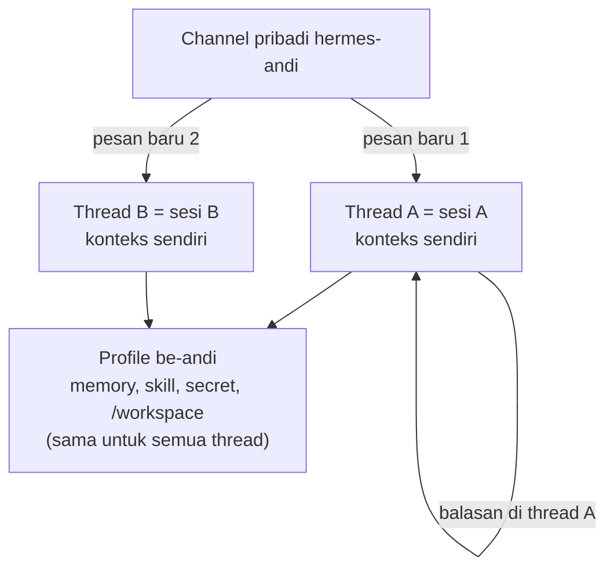

# Panduan anggota

Ringkasan cara memakai Hermes untuk anggota tim.

## 7. Untuk anggota: model terkunci

- Model ditentukan admin per profile. `/model`, `/moa`, `/reasoning`, `/fast`, `/tools`,
  `/toolsets`, `/config`, `/reload`, `/skills`, `/busy`, `/yolo`, `/restart`, `/update` hanya untuk
  admin (`/whoami` menampilkan level akses).
- Agent tidak bisa mengubah konfigurasinya sendiri: terminal & file berjalan di sandbox Docker
  tanpa akses ke `~/.hermes`.
- Provider, model auxiliary, dan sebagian besar setelan sandbox serta skala dipin di
  `/etc/hermes/config.yaml`; `hermes config set` menolak mengubahnya. Batas CPU/RAM sandbox dan ambang
  kompresi ditulis per profile ([Skala](SKALA.md)) supaya bisa berbeda per orang.
- Bila model utama error atau kena throttle, Hermes otomatis pindah ke `llm.fallback`.

## 8. Secret pribadi anggota

Di channel pribadimu (atau thread di dalamnya):

- `/env-set` → form pribadi: **Nama** (mis. `GH_PAT`) dan **Nilai**. Balasan hanya terlihat olehmu.
- `/env-list` → daftar nama secret (tanpa nilai). `/env-unset key:<nama>` → hapus.
- Di chat cukup sebut namanya: "clone repo pakai `$GH_PAT`". AI memakai `$GH_PAT` di perintah
  sandbox tanpa pernah melihat nilainya.
- **Aturan nama.** Nama secret hanya diterima bila: (1) berawalan **`MY_`** (mis. `MY_STRIPE_KEY`,
  `MY_DB_PASSWORD`, `MY_AWS_KEY_ID`), atau (2) salah satu nama alat dev umum yang pasti tidak dibaca
  Hermes (`GH_PAT`, `GITLAB_PAT`, `NPM_TOKEN`, `PYPI_TOKEN`, `SENTRY_AUTH_TOKEN`, `STRIPE_SECRET`,
  `JIRA_API_TOKEN`, … 27 nama; daftarnya `DEV_TOOL_NAMES` di `plugins/team-guard/secrets.py`), atau
  (3) nama yang didaftarkan admin di `secrets.allow_names`.
  Alasannya: Hermes membaca `.env` profile juga sebagai **konfigurasi**, jadi nama bebas seperti
  `DB_HOST`, `AWS_*`, atau `GITHUB_TOKEN` bisa bentrok dengan setelan Hermes atau menyalakan fitur yang tidak
  seharusnya. Petakan ke nama yang dibutuhkan alat saat dipakai:
  `GH_TOKEN=$GH_PAT gh pr list`, `AWS_ACCESS_KEY_ID=$MY_AWS_KEY_ID aws s3 ls`.
  `/env-list` menandai nama lama yang kini tidak memenuhi aturan beserta saran gantinya; tidak ada yang
  dihapus dan nilainya tetap bekerja.
- **Aturan nilai.** Nilai ditolak bila berisi lebih dari satu baris, karakter kontrol atau pemisah baris
  Unicode (TAB boleh), atau `${` (mencegah ekspansi variabel). Nama harus huruf besar ASCII
  (`^[A-Z][A-Z0-9_]{1,63}$`). Setelah ditulis, nilai dibaca ulang; bila tidak cocok, perubahan dibatalkan.
- Nilai multi-baris (private key) simpan sebagai base64 dengan nama berakhiran `_B64`.

Lapisan perlindungan:

1. **Input di luar chat** — modal Discord, balasan ephemeral. Nilai tidak masuk transcript, sesi,
   memory, atau log Hermes.
2. **Tersimpan per profile** — `~/.hermes/profiles/<profile>/.env` mode 0600. Profile lain (dan
   sandbox-nya) tidak bisa membacanya.
3. **Masuk sandbox hanya sebagai env var** lewat `terminal.env_passthrough`. Nama yang dipakai
   Hermes (kredensial provider, gerbang akses Discord, setelan sandbox, `TD_API_KEY`) ditolak.
4. **Output disamarkan** — nilai dan bentuk turunannya (base64, url-encode, hex, dibalik, huruf
   besar/kecil) diganti `«secret:NAMA»` di output terminal, hasil tool, dan jawaban AI.
5. **Saringan terakhir sebelum provider** — setiap request agent ke model disaring lagi: nilai
   tersimpan di seluruh payload, plus token vendor yang jelas (`ghp_…`, `sk-…`, `AKIA…`, JWT, private
   key) di pesan user. Input kompresi konteks disaring Hermes memakai nilai yang didaftarkan plugin.
6. **Guard perintah (best-effort)** — dump environment yang umum diblokir: `env`/`printenv`,
   `set`, `export -p`, `declare -x`, `/proc/*/environ`, `echo $SECRET`, `print(os.environ)`,
   `console.log(process.env)`, dll.
7. **Chat** — token/password yang ditempel di chat disamarkan sebelum sampai ke AI; token yang jelas
   dihapus dari channel dan pengirimnya diingatkan memakai `/env-set`.
8. **Skill yang dibagikan dipindai** dari salinan beku — ditolak kalau memuat nilai secret pemiliknya,
   pola kredensial, atau symlink.
9. Opsional: **egress proxy bawaan Hermes** (`hermes egress install/setup/start`, iron-proxy) — sandbox hanya memegang token proxy, kunci provider asli tetap di host, dan lalu lintas keluar dibatasi ke host yang diizinkan (`proxy.extra_allowed_hosts`). Gantikan `sandbox.network/http_proxy` buatan sendiri bila memakainya. Alternatif keras: `terminal.docker_network: false` (tanpa jaringan sama sekali).

Batas yang perlu diketahui tim:

- Penyamaran mencocokkan nilai persis dan bentuk turunan di atas. Potongan atau transformasi lain
  bisa lolos, dan guard perintah bisa diakali; perintah yang *memakai* secret memang mengirimnya ke
  tujuan itu. Karena itu: token dengan scope minimal, dan pertimbangkan egress allowlist.
- Pesan yang dikirim saat bot sedang sibuk masuk antrean Hermes tanpa lewat hook dispatch. Token yang
  jelas tetap dihapus dari channel dan disamarkan sebelum ke model, tapi teks mentahnya tersimpan
  di riwayat sesi di server. Aturan tim: jangan tempel secret di chat.
- "Privat" berarti tertutup dari rekan tim, **bukan** dari operator server (root / user `hermes`)
  maupun admin Discord yang punya izin Administrator.

## 9. Konteks & memory tidak campur aduk

- Satu profile per orang: memory (`MEMORY.md`, `USER.md`), skill, dan riwayat sesi sendiri. Profile
  baru dari onboarding selalu mulai dengan memory kosong.
- #hermes-shared: tiap orang sesi sendiri per thread (`group_sessions_per_user`). Memory & skill
  bersama hanya ditulis setelah admin menyetujui (`/memory pending`, `/skills pending`).
- Memory bawaan Hermes dibatasi (±2.200 karakter MEMORY + ±1.400 USER), jadi tidak membengkak.
- **Satu percakapan = satu thread.** Di channel pribadimu tiap pesan baru (bukan balasan) otomatis membuka
  thread baru dengan sesi dan konteks sendiri; lanjutkan diskusi dengan membalas di dalam thread itu dan
  konteksnya tidak berubah. Topik lain → tulis lagi di channel utama (thread baru). Memory, skill, secret, dan
  sandbox `/workspace`-mu sama di semua thread. Thread lama bisa dilanjutkan kapan saja (Discord membuka
  kembali thread yang diarsipkan); sesi yang dibuka lagi setelah 1 jam diringkas dulu (`idle_compact_after_seconds`).
  Atur di `team.yaml` → `threads` (`personal`, `admin`); `/new` di dalam thread tetap mengosongkan sesinya.
  Batas Discord: ±1000 thread aktif per server dan thread otomatis diarsipkan — bukan masalah untuk 20 orang.
