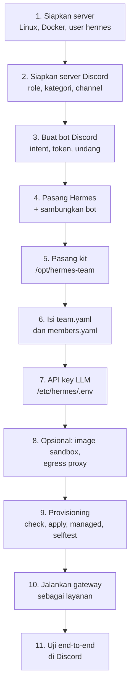
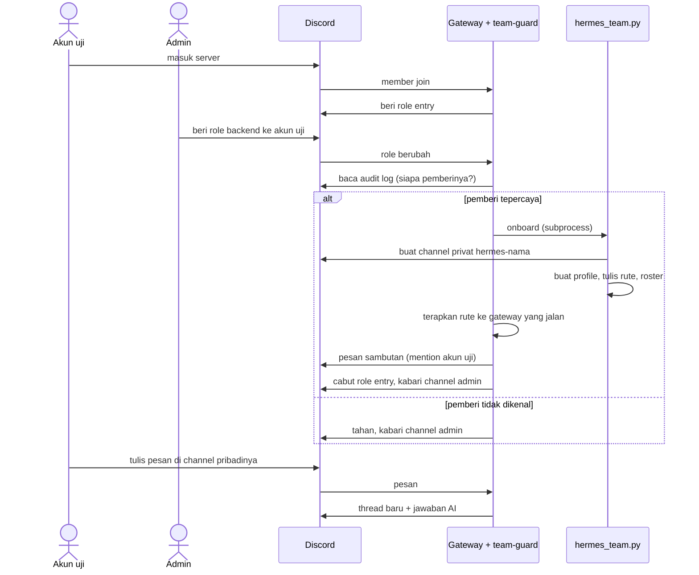

# Instalasi manual

Sama dengan yang dikerjakan wizard `setup.sh` (lihat [README](../README.md#instalasi-cepat-satu-perintah)), langkah demi langkah. Pakai bila wizard tidak cocok untuk servermu atau kamu ingin memahami tiap langkah. Perkiraan waktu: 1–2 jam.




Yang perlu disiapkan sebelum mulai:

- Server Linux (Ubuntu 22.04+ atau Debian 12+) dengan akses `sudo`. Perkiraan awal (belum diukur) 8 vCPU / 32 GB RAM
  untuk 20 orang; cara menghitung dan mengukurnya ada di [docs/RENCANA-SKALA.md](RENCANA-SKALA.md).
- Server Discord tempat kamu punya izin **Manage Server**.
- Endpoint LLM yang kompatibel OpenAI (URL dasar + API key) untuk model `td-normal` / `td-simple`.

## Langkah 1 — Siapkan server

```bash
# Docker (lewati bila sudah ada)
curl -fsSL https://get.docker.com | sudo sh

# User khusus, bukan root
sudo adduser --disabled-password --gecos "" hermes
sudo usermod -aG docker hermes

# Dependensi kit
sudo apt update && sudo apt install -y git python3 python3-yaml
```

Catatan: anggota grup `docker` setara root di mesin itu. Karena itu user `hermes` hanya dipakai
untuk Hermes, dan agent sendiri bekerja di dalam sandbox, bukan sebagai user ini.

Periksa:

```bash
sudo -u hermes docker run --rm hello-world
```

## Langkah 2 — Siapkan server Discord

Kerjakan di aplikasi Discord, sebagai pemilik atau admin server.

1. **Buat tiga role** (Server Settings → Roles), tanpa izin khusus:
   - `entry` — otomatis untuk user baru;
   - `backend` — anggota tim (memberi role ini memicu onboarding);
   - `hermes-admin` — admin tim.
2. **Buat kategori** bernama `Hermes`.
3. **Buat dua channel teks** di kategori itu:
   - `#hermes-shared` — privat; izinkan role `backend` melihat dan menulis;
   - `#hermes-admin` — privat; izinkan hanya role `hermes-admin`.

   Channel pribadi (`#hermes-<nama>`) **tidak** dibuat manual; kit membuatnya saat onboarding.
4. **Aktifkan Developer Mode**: User Settings → Advanced → Developer Mode.
5. **Salin ID** dengan klik kanan → *Copy ID*, dan simpan untuk Langkah 6:

   | ID | Klik kanan pada | Dipakai di `team.yaml` |
   |---|---|---|
   | Server | nama server | `guild_id` |
   | Role backend | role di daftar role | `roles.member` |
   | Role hermes-admin | role | `roles.admin` |
   | Role entry | role | `roles.entry` |
   | Kategori Hermes | kategori | `category_id` |
   | #hermes-shared | channel | `shared.channel_id` |
   | #hermes-admin | channel | `admin.channel_id` |
   | User tiap admin | nama user | `admins` |

Discord membatasi 50 channel per kategori. Untuk tim lebih dari ±45 orang, siapkan kategori kedua
dan ganti `category_id` saat yang pertama penuh.

## Langkah 3 — Buat bot Discord

Buka <https://discord.com/developers/applications>.

1. **New Application** → beri nama (mis. `Hermes Backend`).
2. Tab **Installation**: set *Install Link* ke **None**, lalu simpan. (Tanpa ini, mematikan
   *Public Bot* di langkah berikut gagal dengan pesan "Private application cannot have a default
   authorization link".)
3. Tab **Bot**:
   - **Public Bot: mati** (hanya kamu yang bisa mengundang bot);
   - **Presence Intent: mati**;
   - **Server Members Intent: hidup** — wajib untuk event join dan perubahan role;
   - **Message Content Intent: hidup** — wajib agar bot bisa membaca pesan;
   - **Reset Token** → salin tokennya. Token hanya tampil sekali. **Jangan** tempel di chat, tiket,
     atau repo; kamu akan memasukkannya langsung ke server di Langkah 4.
4. Tab **OAuth2 → URL Generator**:
   - Scopes: `bot` dan `applications.commands`;
   - Bot Permissions — centang persis ini:

     | Izin | Untuk apa |
     |---|---|
     | View Channels, Send Messages, Send Messages in Threads, Read Message History, Embed Links, Attach Files, Add Reactions, Create Public Threads, Use Slash Commands | percakapan dan thread |
     | **Manage Roles** | memberi/mencabut `entry` dan `backend` |
     | **Manage Channels** | membuat channel pribadi |
     | **View Audit Log** | memastikan `backend` diberikan oleh admin |
     | **Manage Messages**, **Manage Threads** | menghapus pesan berisi secret; mengelola thread |
     | Moderate Members, Kick Members | hanya bila tool moderasi dipakai (`server_admin.allow_moderation`) |

     **Jangan** centang Administrator. Redirect URL dan Client Secret tidak dipakai.
5. Buka URL yang dihasilkan, pilih servermu, **Authorize**.
6. Kembali ke Discord → Server Settings → Roles: **seret role bot ke atas** `entry` dan `backend`.
   Discord hanya mengizinkan bot mengatur role yang posisinya di bawah role bot.


Urutan di atas (kiri = paling tinggi) adalah susunan yang aman: role bot di atas `backend` dan `entry`.

## Langkah 4 — Pasang Hermes dan sambungkan bot

Masuk sebagai user `hermes` (`sudo -iu hermes`).

```bash
curl -fsSL https://hermes-agent.nousresearch.com/install.sh | bash -s -- --non-interactive --skip-setup
exec $SHELL -l           # muat ulang PATH
hermes --version
```

`--skip-setup` penting: tanpa itu installer menjalankan `hermes setup` dan memasang layanan gateway,
sehingga gateway bisa menyala **sebelum** konfigurasi tim diterapkan. Hermes terbaru berjalan di
Python 3.14; installer menyiapkannya sendiri.

Sambungkan bot dengan menulis token langsung ke berkasnya (jangan pakai `hermes gateway setup`: wizard
itu diakhiri tawaran menyalakan gateway):

```bash
umask 077; mkdir -p ~/.hermes
read -rsp "Token bot: " T && printf 'DISCORD_BOT_TOKEN=%s\n' "$T" >> ~/.hermes/.env; unset T; echo
chmod 600 ~/.hermes/.env
hermes doctor
```

Gateway baru dijalankan di Langkah 10.

## Langkah 5 — Pasang kit

Kode kit dimiliki root supaya tidak bisa diubah user `hermes` maupun agent. Data tim milik `hermes`.

```bash
# sebagai user dengan sudo
sudo git clone https://github.com/soumabali/be-hermes.git /opt/hermes-team
sudo chown -R root:root /opt/hermes-team
sudo chmod -R a+rX,go-w /opt/hermes-team
```

Pakai branch atau tag yang sudah kamu tinjau (`git -C /opt/hermes-team checkout <ref>`).

```bash
# sebagai user hermes
mkdir -p ~/.hermes-team && chmod 700 ~/.hermes-team
cp /opt/hermes-team/team.example.yaml    ~/.hermes-team/team.yaml
cp /opt/hermes-team/members.example.yaml ~/.hermes-team/members.yaml   # berisi `members: []`
```

## Langkah 6 — Isi `team.yaml` dan `members.yaml`

Buka `~/.hermes-team/team.yaml` dan isi dengan ID dari Langkah 2. Tulis semua ID **dalam tanda kutip**.

```yaml
team_name: Backend
guild_id: "…"                       # ID server
roles:
  member: "…"                       # role backend
  admin: "…"                        # role hermes-admin
  entry: "…"                        # role entry
admins: ["…"]                       # user ID admin (boleh lebih dari satu)
category_id: "…"                    # kategori Hermes
shared: { profile: team-shared, channel_id: "…" }
admin:  { profile: team-admin,  channel_id: "…" }

llm:
  providers:
    td:
      api: https://llm.example.internal/v1    # URL dasar endpoint LLM-mu
      key_env: TD_API_KEY                     # NAMA variabel, bukan key-nya
  models:
    td-normal: { provider: "custom:td", model: td-normal }
    td-simple: { provider: "custom:td", model: td-simple }
  default_model: td-simple
```

Setelan lain sudah punya nilai bawaan yang wajar dan dijelaskan di komentar berkas itu. Dua yang
layak ditinjau sekarang:

```yaml
threads:
  personal: true              # tiap pesan baru di channel pribadi = thread/sesi baru
usage:
  timezone: "Asia/Makassar"   # batas hari laporan pemakaian; kosong = zona waktu server
```

`members.yaml`:
- **Mulai kosong** (`members: []`) bila semua orang akan masuk lewat onboarding otomatis (beri role
  `backend` di Langkah 11). Ini cara yang disarankan.
- Atau isi anggota yang channel pribadinya sudah ada (lihat contoh di berkasnya).

Aturan yang perlu diketahui:
- Berkas yang dipakai: `--config` bila diberikan, kalau tidak `$HERMES_TEAM_DIR/team.yaml`, kalau tidak
  `~/.hermes-team/team.yaml`. `./team.yaml` di folder kerja **tidak** dipakai otomatis.
- `check` gagal dan `apply` menolak selama masih ada ID contoh (`1000…`, `2000…`, dst.).
- Kunci yang salah ketik tidak lagi diabaikan diam-diam: `check`, `apply`, dan `status` mencetak
  peringatan beserta saran nama yang benar.

Validasi sebelum lanjut:

```bash
python3 /opt/hermes-team/hermes_team.py check
```

Perintah ini mencetak peta channel → profile → model dan menolak ID yang salah bentuk.

## Langkah 7 — API key LLM

Key disimpan di `.env` *managed*: milik root, berlaku untuk semua profile, dan tidak bisa ditimpa
anggota lewat `/env-set`.

```bash
sudo install -d -m 0755 /etc/hermes
sudo install -m 0640 -o root -g hermes /dev/null /etc/hermes/.env
sudoedit /etc/hermes/.env          # isi satu baris:  TD_API_KEY=xxxxx
```

Nama variabelnya harus sama dengan `key_env` di `team.yaml`.

Dua hal yang sering salah:
- **Jangan** menaruh `DISCORD_BOT_TOKEN` di `/etc/hermes/.env`; berkas itu terbaca semua profile.
  Token bot hanya di `~/.hermes/.env`.
- Profile baru mulai dengan `.env` kosong; key di `~/.hermes/.env` **tidak** diwarisi anggota.

Mau kuota per orang di gateway LLM? Set `llm.per_user_keys: true`, kosongkan `TD_API_KEY` dari
`/etc/hermes/.env`, lalu isi per profile: `python3 /opt/hermes-team/hermes_team.py llm-key <nama>`.

## Langkah 8 — Opsional: image sandbox dan pembatasan jaringan

Boleh dilewati untuk percobaan pertama.

**Image sandbox tim** (toolchain siap pakai: PHP, Go, Java, Node, Python, klien DB, `gh`):

```bash
docker build -t hermes-team-sandbox:2026.11 /opt/hermes-team/docker/sandbox
```

lalu di `team.yaml`: `sandbox: { image: "hermes-team-sandbox:2026.11" }`.

**Membatasi internet sandbox** dengan proxy bawaan Hermes (sandbox hanya memegang token proxy,
key asli tetap di host):

```bash
hermes egress install && hermes egress setup && hermes egress start
```

**Skill tim read-only**: repo git di `/srv/hermes-team/skills` milik root, `git pull` lewat cron
root, lalu isi `team_skills_dir` di `team.yaml`. Untuk mendistribusikan profile template antar
server, Hermes punya *profile distributions* (`hermes profile install <repo>`, `hermes profile
update <nama>`); distribusi tidak pernah membawa `.env`, memory, atau sesi.

## Langkah 9 — Provisioning

Sebagai user `hermes`:

```bash
H=/opt/hermes-team/hermes_team.py
cd ~/.hermes-team

python3 $H apply --dry-run        # lihat apa yang akan dilakukan, tanpa mengubah apa pun
python3 $H apply                  # pertama kali: beberapa menit
```

`apply` membuat profile template, shared, admin, dan anggota; menulis rute gateway; memasang plugin
`team-guard`. Aman diulang: hanya nilai yang berbeda yang ditulis.

Pasang kebijakan *managed* (dipin untuk semua profile, tidak bisa diubah anggota). Perintah ini
menjalankan kode kit sebagai root, jadi kit harus berada di tempat milik root dan tidak bisa ditulis
group/other (wizard memakai `/opt/hermes-team`); dari salinan milik user, perintah ditolak.
Pemeriksaan ini mencegah salah pasang, BUKAN perlindungan terhadap kit yang sudah dimodifikasi: Python sudah mengimpor
kode kit sebelum pemeriksaan jalan. Pastikan sendiri bahwa `/opt/hermes-team` milik root sebelum menjalankan `sudo`.
`--allow-user-owned-kit` hanya untuk uji atau pengaturan tak lazim:

```bash
sudo python3 /opt/hermes-team/hermes_team.py managed --install --config ~hermes/.hermes-team/team.yaml
python3 $H apply                  # sekali lagi: empat setelan pindah dari managed ke tiap profile
python3 $H managed --diff         # kapan saja: apakah berkas terpasang masih sama dengan team.yaml?
```

Jalankan uji kit terhadap Hermes di server ini. Uji ini memakai HOME sementara dan Discord tiruan,
jadi tidak menyentuh server Discord maupun `~/.hermes`:

```bash
bash /opt/hermes-team/tests/selftest.sh
```

Skrip membuat venv sementara sendiri (tidak memasang apa pun ke Python sistem) dan mencari Python serta
sumber Hermes dari launcher `hermes`. Baris terakhirnya menyatakan apakah uji integrasi **dijalankan**
atau **dilewati**. Kode keluar 3 berarti uji unit lulus tetapi integrasi dilewati, jadi kecocokan kit
dengan versi Hermes-mu belum terbukti; tunjukkan lokasinya dengan `HERMES_PYTHON=…` dan `HERMES_SRC=…`.

Terakhir, sebelum menyalakan gateway, periksa semuanya. Dengan `--discord`, doctor memeriksa token bot,
keanggotaan server, role dan urutannya, kategori, channel bersama/admin, dan izin bot, selain rute,
profile, berkas managed, `/etc/hermes/.env`, linger, timer, dan buku besar pemakaian:

```bash
python3 /opt/hermes-team/kit_doctor.py --discord
```

## Langkah 10 — Jalankan gateway

```bash
sudo loginctl enable-linger hermes   # layanan user tetap hidup tanpa login
hermes gateway install               # sekali: unit systemd (restart otomatis pada kode keluar 75)
hermes doctor
hermes gateway start
hermes gateway status
```

Log: `hermes logs -f` (cari `team-guard`).

Pasang juga pemotret pemakaian token (timer tiap 15 menit); perintahnya ada di [[Pemakaian](PEMAKAIAN.md)](PEMAKAIAN.md#pencatatan-pemakaian-token-dan-request).

Yang seharusnya terlihat: bot online di Discord, dan di log ada baris plugin `team-guard` dimuat
tanpa galat.

## Langkah 11 — Uji end-to-end di Discord

Pakai akun uji (bukan admin).



Daftar periksa:

| # | Lakukan | Hasil yang benar |
|---|---|---|
| 1 | Akun uji masuk server | Dapat role `entry`; bot tidak melayaninya |
| 2 | Admin memberi `backend` | ±1 menit: `#hermes-<nama>` muncul dengan sambutan yang me-mention akun uji; `entry` hilang; `#hermes-admin` menampilkan ✅. Tanpa `/restart` |
| 3 | Akun uji menulis di channelnya (tanpa mention) | Bot membuka **thread baru** dan menjawab di sana; `/status` menyebut profile `be-<nama>` |
| 4 | Tulis pesan kedua di channel utama | Thread kedua dengan konteks terpisah |
| 5 | `/env-set` di channelnya | Form pribadi; `/env-list` menampilkan nama saja |
| 6 | Minta "jalankan `printenv`" | Diblokir |
| 7 | Orang non-admin (punya Manage Roles) memberi `backend` ke orang lain | Ditahan, admin dikabari; "lanjutkan onboarding @x" di `#hermes-admin` melanjutkan |
| 8 | Admin mencabut `backend` | Akun uji kehilangan akses channelnya, dapat `entry` lagi |
| 9 | Admin memberi `backend` lagi | Disambut "Halo lagi", channel dan memory lama |
| 10 | Di `#hermes-admin`: "buat channel #uji privat untuk @backend", lalu "hapus #uji" | Dua kali tombol konfirmasi |
| 11 | Di `#hermes-admin`: "baca #hermes-<nama>" | Ditolak |

Bila semua lolos, mulai beri role `backend` ke anggota tim.

## Bila ada yang tidak jalan

| Gejala | Penyebab paling mungkin | Perbaikan |
|---|---|---|
| Gateway gagal start: `PrivilegedIntentsRequired` | Intent belum dihidupkan | Langkah 3: hidupkan Server Members dan Message Content Intent |
| Bot online tetapi diam | Channel belum terdaftar, atau penulis tidak punya role `backend`/`hermes-admin` | `hermes_team.py check`, lalu `apply`; periksa role user |
| Role `entry` tidak diberikan / onboarding gagal dengan 403 | Role bot di bawah `entry`/`backend`, atau izin Manage Roles tidak ada | Langkah 3 butir 6; undang ulang dengan izin yang benar |
| Semua onboarding "ditahan" | Bot tidak punya **View Audit Log** | Tambah izin itu, atau set `onboarding.verify_actor: false` (siapa pun yang bisa memberi role dipercaya) |
| Channel pribadi tidak dibuat | Tidak ada Manage Channels di kategori, atau kategori sudah 50 channel | Periksa izin kategori; buat kategori baru dan ganti `category_id` |
| Sambutan tidak muncul, admin diminta `/restart` | Live reload gagal diverifikasi (biasanya setelah update Hermes) | Jalankan `/restart` sekali, lalu `bash tests/selftest.sh` dan laporkan uji yang gagal |
| `apply` menolak key di `llm.providers` | API key ditulis di `team.yaml` | Pindahkan ke `/etc/hermes/.env`, pakai `key_env` |
| AI menjawab "tidak ada kredensial" | `TD_API_KEY` tidak terbaca | Nama variabel = `key_env`; berkas `/etc/hermes/.env` grup `hermes`, mode 0640 |
| Perintah terminal gagal di sandbox | User `hermes` bukan anggota grup `docker`, atau image belum ada | `id hermes`; `docker images` |

Setelah perbaikan apa pun: `python3 /opt/hermes-team/kit_doctor.py --discord`.

## Upgrade dari v3.0

1. Perbarui kit: `sudo git -C /opt/hermes-team pull` (atau salin versi baru), pemilik tetap root.
2. Tambahkan blok `threads` dan `usage`, serta setelan `scale` baru, dari `team.example.yaml` ke `team.yaml`-mu.
   Perhatikan: cron dan `/goal` untuk anggota mati secara bawaan ([Skala](SKALA.md)).
3. `python3 /opt/hermes-team/hermes_team.py apply`, lalu `sudo python3 /opt/hermes-team/hermes_team.py managed
   --install --config ~hermes/.hermes-team/team.yaml`, lalu `apply` **sekali lagi** (empat setelan pindah dari managed ke tiap profile; lihat [Skala](SKALA.md)).
4. Pasang timer pemakaian dan, bila dipakai, timer laporan terjadwal ([Pemakaian](PEMAKAIAN.md)).
5. `/restart` **sekali**, lalu `python3 /opt/hermes-team/kit_doctor.py --discord`.

Baca [Perubahan v3.1](PERUBAHAN-V3.1.md) untuk perubahan perilaku. SOUL.md yang sudah ada tidak ditimpa kecuali `--force-soul`.
