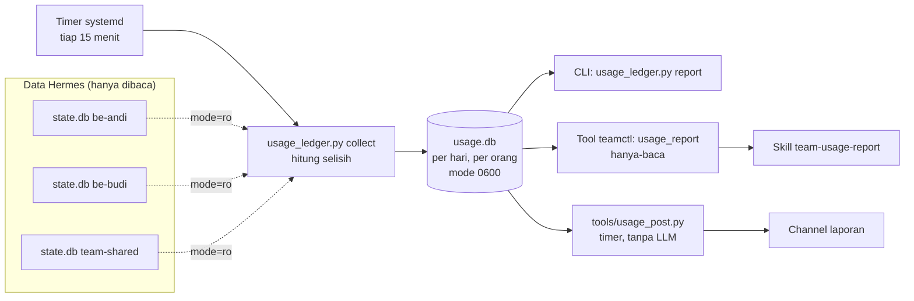

# Pencatatan pemakaian token dan request

`usage_ledger.py` mencatat pemakaian LLM **per orang, per hari** ke buku besar sendiri
(`~/.hermes-team/state/usage.db`), sehingga laporan harian, mingguan, dan bulanan bisa diambil kapan saja.



**Yang dicatat:** request ke model (`api_call_count`), token masuk, token keluar, token cache dan
reasoning, jumlah sesi, biaya, per model. "Request" adalah panggilan API ke model, bukan jumlah pesan;
satu pesan bisa menghasilkan banyak request.

**Atribusi per orang:** pemakaian dipasangkan ke user Discord pengirimnya (kolom `user_id` di tabel
`sessions` Hermes), jadi pemakaian di `#hermes-shared` terbagi ke orang yang benar. Sesi tanpa pengirim
(cron, subagent) ikut pemilik profile; di profile bersama ia tampil sebagai "(team-shared, tanpa pengirim)".

**Kenapa aman:**
- `state.db` Hermes dibuka hanya-baca; kit tidak pernah menulis ke data Hermes.
- Buku besar hanya berisi angka, nama model, nama profile, dan ID user. Tidak ada isi percakapan,
  judul sesi, prompt, atau secret.
- Berkasnya bermode 0600 di folder 0700 milik user `hermes`; satu penulis pada satu waktu (kunci
  berkas), tiap profile satu transaksi.
- Riwayat tetap ada walau sesi di Hermes dihapus (`hermes sessions prune`); disimpan ±800 hari.
- Agent tidak bisa membukanya dari sandbox Docker. Satu-satunya jalur untuk AI adalah tool
  `usage_report`, yang hanya-baca dan hanya ada di profile `team-admin`.

**Pasang pemotret berkala** (sekali, sebagai user `hermes`):

```bash
mkdir -p ~/.config/systemd/user
cp /opt/hermes-team/systemd/hermes-usage-collect.* ~/.config/systemd/user/
systemctl --user daemon-reload
systemctl --user enable --now hermes-usage-collect.timer
```

Atur zona waktu batas hari di `team.yaml` → `usage.timezone` (mis. `Asia/Makassar`). Potret pertama
menaruh riwayat lama pada hari tiap sesi terakhir aktif.

**Ambil data kapan saja:**

```bash
U=/opt/hermes-team/usage_ledger.py
python3 $U report --period day                              # hari ini
python3 $U report --period day --last 7                     # 7 hari terakhir, per hari
python3 $U report --period week --offset 1 --format markdown  # minggu lalu
python3 $U report --period month --user budi --format json  # satu orang, data mentah
```

Di `#hermes-admin` cukup tulis biasa, misalnya "pemakaian token minggu lalu" atau "pemakaian budi bulan
ini". Hermes memanggil tool `usage_report` (tanpa tombol konfirmasi, karena hanya membaca) lewat skill
`team-usage-report`, yang melarang AI mengubah atau mengarang angka.

**Laporan terjadwal ke channel.** `tools/usage_post.py` mengirim laporan harian, mingguan, dan bulanan
ke satu channel Discord. Angkanya diambil langsung dari buku besar, **tanpa memanggil model**, jadi tidak
memakai token dan tidak mungkin salah kutip. Atur di `team.yaml`:

```yaml
usage:
  timezone: "Asia/Makassar"
  report_channel_id: "…"          # channel teks di server ini; kosong = fitur mati
  reports:
    daily: "08:00"                # laporan KEMARIN, tiap hari
    weekly: "08:30"               # laporan MINGGU LALU, tiap Senin
    monthly: "09:00"              # laporan BULAN LALU, tiap tanggal 1
```

Tulis jamnya dalam tanda kutip. Buat channelnya sendiri di Discord (mis. `#hermes-usage`, hanya terlihat
admin) dan pastikan bot boleh menulis di sana; channel itu **tidak** dirutekan ke profile mana pun, jadi
tidak ada yang bisa mengajak AI bicara di sana. Lalu pasang timernya:

```bash
cp /opt/hermes-team/systemd/hermes-usage-report.* ~/.config/systemd/user/
systemctl --user daemon-reload
systemctl --user enable --now hermes-usage-report.timer

python3 /opt/hermes-team/tools/usage_post.py --list        # jadwal, jatuh tempo berikutnya, terakhir terkirim
python3 /opt/hermes-team/tools/usage_post.py --dry-run     # lihat isi tanpa mengirim
python3 /opt/hermes-team/tools/usage_post.py --force daily # kirim sekarang
```

Tiap laporan dikirim tepat sekali per periode; bila server mati pada jamnya, laporan disusulkan saat
menyala (hanya periode terakhir). Saat pertama diaktifkan, periode terakhir tiap jenis langsung dikirim.
Pesan tidak me-mention siapa pun.

Skill `team-usage-report` tetap dipakai untuk pertanyaan bebas di `#hermes-admin`. Laporan terjadwal
sengaja tidak memakai cron Hermes: dengan `strict_admin_routes: true`, hasil cron profile `team-admin`
tidak bisa dikirim ke `#hermes-admin` ([Batasan](BATASAN.md)), dan membuka rute ke profile admin dari channel lain akan
melemahkan pagar admin.

Ketelitian: pemakaian dicatat pada hari saat dipotret, jadi selisih di sekitar tengah malam bisa
bergeser paling lama selang timer (15 menit; timer juga berjalan pukul 23.59.30).
`usage_report.py` yang lama tetap ada untuk melihat `state.db` secara langsung tanpa buku besar.
