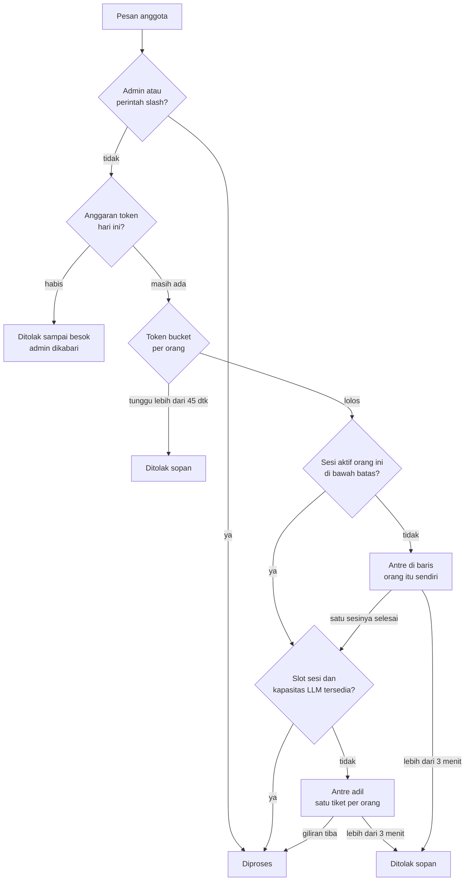

# Skala 20 orang

Pembatas bekerja berlapis. Semua angka diatur di `team.yaml` → `scale`.



| Masalah | Mekanisme | Setelan |
|---|---|---|
| Satu orang membanjiri pesan | Token bucket per orang: 4 pesan langsung, lalu 6/menit; ditolak sopan bila harus menunggu > 45 detik | `user_rate_per_minute`, `user_burst` |
| Satu orang membuka banyak thread sekaligus | Maks 2 sesi aktif per orang; pesan berikutnya menunggu di barisnya sendiri | `user_max_concurrent` |
| Semua orang bersamaan | Maks 8 sesi anggota aktif (+2 slot admin); antrean **adil**: satu tiket per orang, bergiliran; maks 3 menit | `max_concurrent_sessions`, `admin_reserved_slots`, `queue_max_wait_seconds` |
| Beban LLM tak terlihat (cron, subagent) | Panggilan LLM yang sedang berjalan dihitung dari hook API; bila mencapai batas, pesan baru antre | `max_llm_parallel` (isi dari `tools/probe_llm.py`) |
| Endpoint mengembalikan 429 | Retry dan fallback bawaan Hermes; **pembatas adaptif**: 3× 429 dalam 60 detik → batas sesi efektif dibagi dua, pulih +1 per menit setelah tenang; admin dikabari | `adaptive_throttle`, `llm.fallback` |
| Biaya tak terkendali | Anggaran token harian per orang dan per tim dari buku besar pemakaian: 80% diperingatkan, 100% ditolak sampai tengah malam; admin bisa menambah jatah hari itu | `daily_token_budget`, `team_daily_token_budget` |
| Agent berputar terlalu lama | Maks 60 langkah tool per giliran; subagent maks 1; `/goal` mati untuk anggota (bila dibuka: maks 4 lanjutan) | `agent_max_turns`, `delegation_max_children`, `allow_goals`, `goals_max_turns` |
| Cron menumpuk | Toolset cron mati untuk anggota dan `#hermes-shared`; bila dibuka, jadwal lebih rapat dari 15 menit ditolak; cron memakai model murah, satu job per profile sekaligus | `allow_member_cron`, `cron_min_interval_minutes` |
| Riwayat chat membengkak | Kompresi paling lambat di 64k token; output tool lama dipangkas tanpa LLM; sesi yang dibuka lagi setelah 1 jam diringkas dulu | `compression_threshold_tokens`, `proactive_prune_tokens`, `idle_compact_after_seconds` |
| `state.db` tumbuh terus | Sesi yang sudah berakhir lebih dari 90 hari dipangkas Hermes (riwayat pemakaian tetap ada di buku besar) | `session_retention_days` |
| Mengirim pesan saat bot sibuk | Masuk antrean sesi, tidak memotong pekerjaan | `busy_input_mode: queue` |
| Tugas kecil memakai model mahal | Tugas auxiliary ke model murah, judul sesi tanpa LLM | `llm.aux_model`, `title_llm` |
| Banyak orang di-onboard sekaligus | `onboard-batch`: semua channel dibuat, lalu satu `apply`; onboarding lewat role tetap berurutan | `onboarding.*` |
| Beban RAM | Sandbox 1 GB per orang secara bawaan, bisa dinaikkan per anggota; `check` menghitung kasus terburuk dan memperingatkan bila melebihi RAM server; browser otomatis & computer use mati; `kit_doctor.py --docker` melaporkan RAM tiap sandbox | `sandbox.memory_mb`, `members.yaml` → `sandbox`, `allow_browser: false` |
| Model berbeda, jendela konteks berbeda | Ambang kompresi bisa diatur per model | `llm.models.<alias>.compression_threshold_tokens`, `.proactive_prune_tokens` |

## Mengukur, bukan menebak

```bash
# 1. Kapasitas endpoint LLM → saran max_llm_parallel dan max_concurrent_sessions
TD_API_KEY=… python3 /opt/hermes-team/tools/probe_llm.py --team ~/.hermes-team/team.yaml --alias td-simple

# 2. Beban sekarang: di #hermes-admin tulis "bagaimana beban sekarang?" (tool team_status), atau
cat ~/.hermes-team/state/metrics.json

# 3. RAM sandbox dan ukuran state.db
python3 /opt/hermes-team/kit_doctor.py --docker
```

`probe_llm.py` mengirim permintaan pendek sungguhan ke endpoint (memakai kuota), membaca key dari
variabel lingkungan, dan tidak pernah mencetaknya.

`metrics.json` ditulis plugin tiap 30 detik: sesi aktif, sesi per orang, panggilan LLM berjalan,
panjang dan lama antrean, jumlah penolakan per jenis, 429 per menit, batas efektif. Admin dikabari
bila antrean lebih dari 5 selama 2 menit atau ada penolakan karena antrean penuh.

Untuk Prometheus: `tools/metrics_export.py --output <berkas .prom>` mengubah `metrics.json` menjadi format
textfile collector node_exporter (`hermes_team_active_sessions`, `hermes_team_queue_length`,
`hermes_team_refused_total{reason=…}`, dst.). Jalankan sebagai user `hermes` tiap menit lewat cron;
berkas keluarannya hanya berisi angka dan ID user.

Menambah jatah token seseorang untuk hari ini: di `#hermes-admin` tulis "tambah kuota budi 2 juta
token" (tool `set_usage_budget_extra`, dengan tombol konfirmasi). Tambahan hangus saat hari berganti.

## Memori sandbox per anggota

```bash
python3 /opt/hermes-team/hermes_team.py set-sandbox budi --memory-mb 4096 --cpu 2   # naikkan untuk satu orang
python3 /opt/hermes-team/hermes_team.py set-sandbox budi --reset                    # kembali ke bawaan tim
```

Atau tulis `sandbox: {memory_mb: 4096, cpu: 2}` pada anggota itu di `members.yaml`, lalu `apply`.
Container yang sudah ada tetap memakai batas lama sampai dibuat ulang.

## Yang perlu diketahui

- **Hanya perintah kontrol yang bebas pembatas:** `/stop`, `/approve`, `/deny`, `/status`, `/context`,
  `/usage`, `/help`, `/commands`, `/whoami`, `/new`, `/reset`, `/title`, `/sessions`. Perintah lain yang
  memulai giliran AI (`/btw`, `/retry`, `/plan`, pemanggilan skill) dan teks apa pun berawalan `/` kena
  anggaran, rate limit, dan antrean seperti pesan biasa.
- **RAM bawaan sandbox turun dari 2 GB ke 1 GB.** Build Java/Maven atau Node yang besar bisa kehabisan
  memori; naikkan per orang dengan `set-sandbox` atau ubah `sandbox.memory_mb`.
- **Empat setelan tidak lagi dipin root:** batas CPU/RAM sandbox dan dua ambang kompresi kini ditulis di
  config tiap profile (supaya bisa berbeda per orang/model), bukan di `/etc/hermes/config.yaml`. Anggota
  tetap tidak bisa mengubahnya (agent bekerja di sandbox tanpa akses ke `~/.hermes`, perintah config
  hanya untuk admin), tetapi operator dengan akses shell bisa.
- **Urutan upgrade penting:** `apply` → pasang ulang `/etc/hermes/config.yaml` (`managed`) → `apply` lagi.
  Selama berkas managed lama masih mengunci empat setelan itu, `apply` melewatinya dan memberi peringatan.

- **Perubahan bawaan saat upgrade:** anggota dan `#hermes-shared` kehilangan toolset cron serta `/goal`
  dan `/subgoal` pada `apply` berikutnya. Buka lagi dengan `allow_member_cron: true` / `allow_goals: true`.
- **Anggaran token butuh buku besar pemakaian** ([Pemakaian](PEMAKAIAN.md)). Tanpa itu anggaran tidak ditegakkan (gagal terbuka,
  satu baris di log). Angka pemakaian bisa tertinggal sampai ±2 menit.
- **Batas per orang baru aktif penuh setelah satu sesi selesai** sejak gateway start; pada menit-menit
  pertama hanya reservasi singkat yang dihitung.
- **Panggilan auxiliary** (judul, kompresi) tidak ikut dihitung di `max_llm_parallel`.
- `check` dan `apply` memberi peringatan bila semua fallback sebuah model ada di provider yang sama;
  contoh konfigurasi bawaan memang memicunya sampai kamu menambah provider kedua.
- `tools/sandbox_idle.py` (menghentikan container sandbox yang menganggur) **hanya melaporkan** secara
  bawaan. Apakah Hermes menyalakan lagi container yang dihentikan belum dibuktikan; uji di server
  percobaan sebelum memakai `--apply`.

Simulasi 20 pengguna (`tests/test_scale_sim.py`) memeriksa bahwa pembatas di atas bekerja bersama:
satu pembanjir tidak membuat orang lain kelaparan, batas tidak pernah terlampaui, pembatas adaptif
turun lalu pulih. Itu simulasi dengan jam tiruan, **bukan** uji terhadap gateway sungguhan; cara uji
manual memakai LLM tiruan ada di [tests/loadtest/README.md](../tests/loadtest/README.md). Status tiap
butir rencana ada di [docs/RENCANA-SKALA.md](RENCANA-SKALA.md).
